# Cloud-Native PostgreSQL as a Production Vector Database on Kubernetes: Infrastructure, Hidden Performance Traps, and How to Avoid Them

_A deep investigation into why pgvector abandons its HNSW index for filtered search, the one missing maintenance step that triggers it, and the problems that still need care once it is fixed._

## Introduction

This investigation started while I was evaluating vector databases for production use. PostgreSQL with pgvector was a strong candidate: a familiar relational database that could store embeddings alongside application data, potentially avoiding a separate database for vector search.

I wanted to base the architecture decision on measurements, so I tested pgvector with 2.5 million vectors, including metadata filtering and hybrid search, and dug into the query plans to understand the results. The findings felt worth sharing with other engineers evaluating vector databases or building infrastructure for production: the setup, the performance traps I ran into, what causes them, and how to avoid them.

### The Short Version

I built a production-style setup on a single Amazon EKS (Elastic Kubernetes Service) cluster: PostgreSQL 18.6 with the pgvector 0.8.7 extension, run by the CloudNativePG operator, holding 2.5 million text chunks with 1,536-dimensional embeddings. A benchmark Job in the same cluster measured three kinds of search: pure vector similarity search, vector search restricted by a metadata condition such as "only chunks from this book" (filtered search), and vector search combined with keyword search (hybrid search). Each ran at 8 concurrency levels and 6 result sizes, with Prometheus and Grafana watching the database.

Filtered search hid a cliff. Asking for 41 nearest neighbours instead of 40 made the same query go from **1.5 ms to 358 ms**, and in the full benchmark, filtered search at 50 concurrent queries went from **37 ms at top_k 20 to 7,999 ms at top_k 50**, with 85% of the top_k 50 and 100 queries not finishing within the benchmark's time budget. The vector index was not at fault. PostgreSQL's query planner, the component that decides how to execute each query, switched away from the vector index to a plan that computes the distance to every row of the book. It did that because it was guessing how many rows match the filter: the table had no statistics for the book field, so the planner assumed 0.5% of the table (12,500 rows) for every book, when the smallest book alone has 63,945.

The fix is one maintenance command: `ANALYZE`, run after the indexes are created. With real statistics the planner kept the vector index at every `LIMIT` up to 200, and the same benchmark showed no cliff: **34 ms at top_k 20 and 90 ms at top_k 50**, with every query completing. Two problems remain even after the fix, and the article covers both: filtered queries can silently return fewer results than requested unless iterative index scans are enabled, and hybrid search is about 3x slower than vector search because PostgreSQL's full-text index finds matching rows but cannot rank them.

### The Three Traps

1. **The filtered search cliff (missing statistics)**: With no statistics for `metadata->>'book_name'`, the planner switched from the HNSW vector index to a "find every matching row, compute every distance, sort" plan at exactly `LIMIT 41`, for every book, regardless of its size. A single query went from 1.5 ms to 358 ms (1.1 seconds for the largest book), and under concurrent load most queries timed out. The trigger is an ordinary loading sequence: insert data, create indexes, start serving. PostgreSQL only collects statistics for an indexed expression when `ANALYZE` runs _after_ that index exists, and nothing in that sequence runs it.
2. **Incomplete filtered results (HNSW post-filtering)**: Even when the planner does use the vector index, the index does not know about the filter. With the default settings it collects 40 candidates and discards those from other books, so `LIMIT 40` returned **18 rows**, quickly and without any error. pgvector's iterative index scans (`hnsw.iterative_scan`) fix this by letting the index keep searching until enough rows pass the filter.
3. **The hybrid search bottleneck**: Hybrid search (vector + full-text via Reciprocal Rank Fusion) is consistently about **3x slower** than pure vector search, with the full-text half consuming most of the time. PostgreSQL's GIN index for full-text search can find all rows containing a keyword quickly, but it cannot rank them by relevance (`ts_rank()`). To return even the top 10, the database fetches every matching row, recomputes its rank and sorts the whole set.

This article walks through the full technical investigation behind these findings, with `EXPLAIN ANALYZE` evidence at every step. It explains the PostgreSQL concepts first, then shows what each trap looks like when it is not avoided, why it happens, and what fixes it. Here is what you will get from it:

- **Production-grade cloud-native infrastructure**: A complete blueprint for deploying PostgreSQL with pgvector on a self-hosted EKS cluster using the CloudNativePG operator, a real-world reference architecture, not a local-machine prototype.
- **Python async client patterns**: How to use `asyncpg` for high-concurrency vector retrieval, index creation, and bulk data ingestion via PostgreSQL's binary `COPY` protocol.
- **Full observability stack**: Prometheus and Grafana setup with custom PostgreSQL metrics dashboards, so you can see exactly how CPU, memory, I/O, and query performance behave under load.
- **Benchmarks at different concurrency and top_k values, with and without the fix**: I tested 2.5 million vectors with 1,536 dimensions, varying the number of queries running at the same time (concurrency) and the number of results requested per query (`top_k`), once in the state an ordinary load leaves behind and once after `ANALYZE`.
- **A five-second check for the trap**: The tell-tale sign in an `EXPLAIN` plan, and the catalog query that confirms it.
- **Why the usual workarounds don't help**: Seven approaches measured side by side — which ones the query planner silently ignores, which one makes things worse, and which one fixes the cause — with the full details in a companion document.
- **Dataset-agnostic benchmarking framework**: Point the included framework at your own vectors and filters to find out whether your data and query patterns hit these traps, before they surprise you in production.

---

## The Setup

### Infrastructure Architecture

The environment uses one Amazon Elastic Kubernetes Service (EKS) cluster, `pgvector-investigation`, in **AWS Mumbai (`ap-south-1`)**. CloudNativePG (CNPG) manages two separate PostgreSQL clusters: the vector database in `cnpg-pgvector` and the small benchmark-results database in `benchmark-results`. Benchmark Jobs run in `benchmarks`, and Prometheus plus Grafana run in `monitoring`. The CNPG operator runs in `cnpg-system`.

<p align="center">
  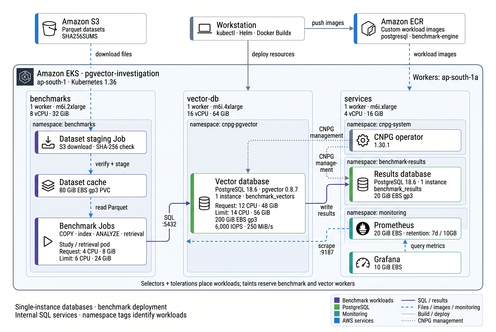
</p>

Amazon ECR stores the custom PostgreSQL + pgvector image and the Python benchmark image. Amazon S3 stores the Parquet datasets. A staging Job copies the files to an EBS-backed PersistentVolumeClaim and verifies their SHA-256 checksums before the timed benchmark starts. Benchmark Jobs connect to PostgreSQL through its internal ClusterIP service on port 5432, then store QPS and latency summaries in the separate CNPG results database. Returned-row counts and failure diagnostics are retained in the Job logs. Database traffic stays inside the cluster. Administrative access uses `kubectl port-forward`.

**Vector database node group:**

- **Node**: EC2 `m6i.4xlarge`, 16 vCPUs and 64 GiB RAM; dedicated node selector and taint.
- **Operator**: CloudNativePG **1.30.1** (Helm chart 0.29.1).
- **Database image**: PostgreSQL **18.6** and pgvector **0.8.7**, built for `linux/amd64` and stored in ECR.
- **Pod allocation**: requests 12 CPU / 48 GiB; limits 14 CPU / 56 GiB, leaving room for the OS and DaemonSets.
- **Storage**: encrypted **200 GiB EBS gp3**, provisioned at **6,000 IOPS and 250 MiB/s**.
- **PostgreSQL settings**: `shared_buffers=4GB`, `effective_cache_size=12GB`, `work_mem=256MB`, `maintenance_work_mem=1GB`, and `random_page_cost=1.1`. These are explicit experimental settings, not an automatic production recommendation.

**Benchmark execution node group:**

- EC2 `m6i.2xlarge`, 8 vCPUs and 32 GiB RAM, reserved for benchmark and staging Jobs.
- An 80 GiB EBS cache holds `gen_wot_2.5m.parquet` and `wot_retrieval_queries.parquet` under `/app/data`.
- Jobs run sequentially against the same data and indexes; the data transfer is outside the timed workload.
- Internal database endpoints: `ml-pgvector-benchmark-rw.cnpg-pgvector.svc.cluster.local` and `benchmark-results-rw.benchmark-results.svc.cluster.local`.

**Supporting services node group:**

- EC2 `m6i.xlarge`, 4 vCPUs and 16 GiB RAM, hosts the operator, results database, and monitoring services.
- The results CNPG cluster uses 20 GiB EBS and stores benchmark metrics only.
- Prometheus retains seven days of metrics on a 20 GiB EBS volume; Grafana uses 10 GiB EBS.

<p align="center">
  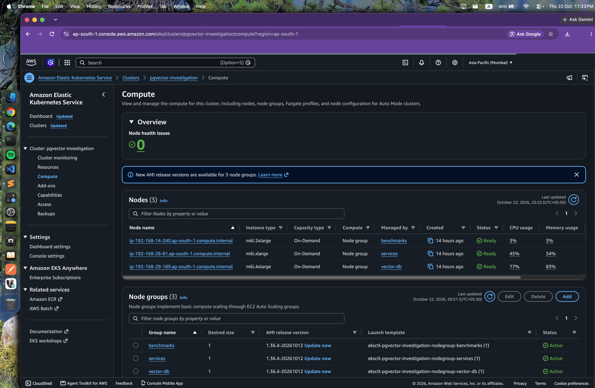
</p>

The pod list confirms the placement: the vector database alone on the m6i.4xlarge node, every benchmark Job on the m6i.2xlarge node, and the operator, results database and monitoring stack on the m6i.xlarge node.

<p align="center">
  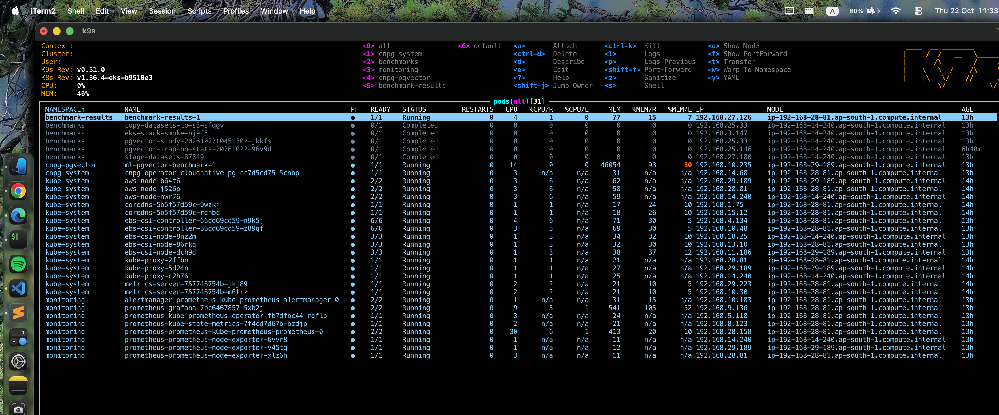
</p>

Both databases have one instance. This is an isolated benchmark environment, **not a high-availability database design**. Worker nodes are in one availability zone to avoid cross-zone traffic during measurements; the EKS control plane spans availability zones. Node-group isolation reduces interference but does not remove every shared-cluster effect.

### Reproducing the Infrastructure

Follow these guides in order. Commands use an explicit project kubeconfig, so they do not switch an unrelated cluster context.

1. **[CNPG_PGVECTOR_SETUP.md](doc/CNPG_PGVECTOR_SETUP.md)**: EKS, node groups, ECR image builds, IAM, EBS storage, and both CNPG database clusters, including exact versions, verification, costs, and teardown.
2. **[CNPG_MONITORING_SETUP.md](doc/CNPG_MONITORING_SETUP.md)**: Prometheus, Grafana, PodMonitors, custom PostgreSQL metrics, dashboards, and the full metrics interpretation reference.
3. **[execution-guide.md](doc/execution-guide.md)**: S3 dataset staging and checksum verification, connection secrets, binary COPY insertion, index builds, retrieval Jobs, result queries, both database states used in this article, diagnostic sweeps, and evidence capture.
4. **[DATASET.md](doc/DATASET.md)**: dataset construction, schemas, and using your own corpus.
5. **[SCREENSHOT_PLAN.md](doc/SCREENSHOT_PLAN.md)** and **[diagram prompts](doc/diagrams/prompts.md)**: AWS console, Grafana, DBeaver, and figure preparation.

**Key infrastructure files:**

- [EKS configuration](infrastructure/aws/eks-cluster.yaml): one cluster and three fixed-size managed node groups.
- [Database Dockerfile](infrastructure/cnpg-pgvector/Dockerfile): PostgreSQL 18.6 plus the pinned pgvector 0.8.7 source revision.
- [Vector Cluster](infrastructure/cnpg-pgvector/cluster.yaml) and [results Cluster](infrastructure/aws/results-cluster.yaml): independent CNPG resources and internal services.
- [EBS storage classes](infrastructure/aws/storage.yaml), [dataset PVC](infrastructure/aws/dataset-pvc.yaml), and [S3 staging Job](infrastructure/aws/dataset-stage.yaml).
- [Monitoring values](infrastructure/cnpg-pgvector/monitoring/values-prometheus-grafana.yaml), [custom metric queries](infrastructure/cnpg-pgvector/monitoring/cnpg-extra-monitoring.yaml), [PodMonitor](infrastructure/cnpg-pgvector/monitoring/cnpg-podmonitor.yaml), and [Grafana dashboard](infrastructure/cnpg-pgvector/monitoring/dashboards/cnpg-pgvector-overview.json).
- [Benchmark image Dockerfile](infrastructure/docker/Dockerfile), [full-study Job](infrastructure/aws/full-study-job.yaml), [retrieval-only Job](infrastructure/aws/retrieval-only-job.yaml) and [deployment helper](scripts/aws/deploy.py).

---

## The Dataset

I used text extracted from EPUB editions of *The Wheel of Time* series as the corpus for these vector-search benchmarks. I split the text into chunks and kept book and chapter metadata for filtered search. The recurring characters, locations, and events provided a range of queries for vector and full-text search.

This article shares the benchmark methodology and performance results. The source EPUB files, extracted-text datasets, embeddings, and query datasets are not distributed with this repository. Book titles identify the source material and filter values. To run the benchmarks, supply your own corpus and query files.

The base dataset contains **100,105 real text chunk embeddings** generated using OpenAI's `text-embedding-ada-002` model (1,536 dimensions). To test pgvector at production scale, I synthetically expanded this to **2.5 million vectors** by duplicating text chunks with varied metadata combinations and generating synthetic embeddings, preserving the original data distribution characteristics while reaching a dataset size that stresses PostgreSQL's query planner and buffer cache.

<p align="center">
  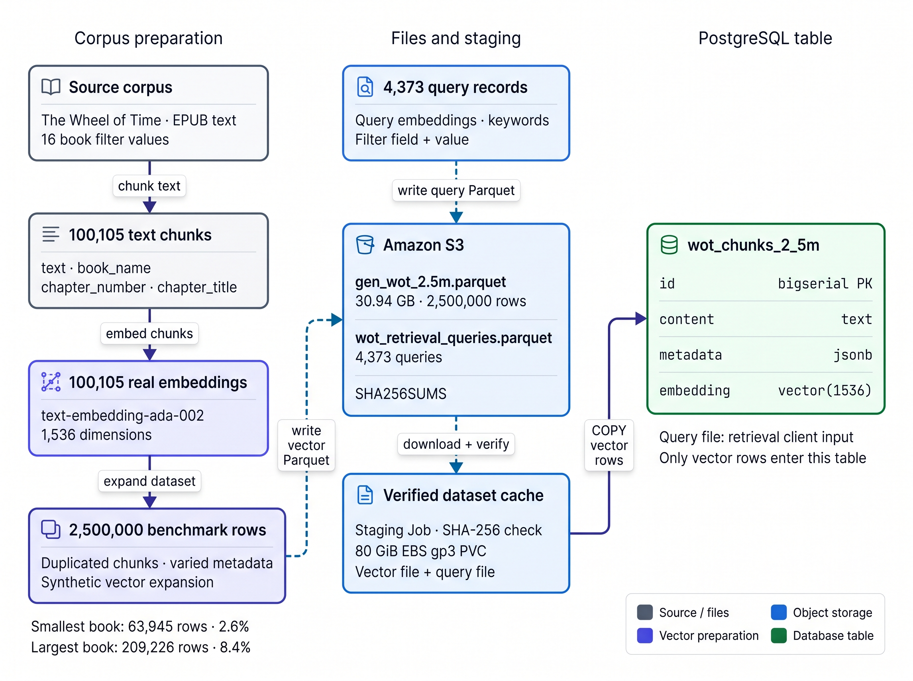
</p>

The benchmark uses two Parquet datasets stored in Amazon S3:

- **Vector dataset** (2.5 million rows, 30.94 GB): Each row contains the text chunk (`text`), its 1,536-dimensional embedding (`embedding`), and metadata fields (`book_name`, `chapter_number`, `chapter_title`). On insert, each row maps to a PostgreSQL table with `content text`, `metadata jsonb`, and `embedding vector(1536)` columns.
- **Query dataset** (4,373 rows): Real questions about the Wheel of Time, each containing a `query_embedding`, extracted `keywords` for hybrid search, and a `filter_field`/`filter_value` pair for filtered search. Every query row is used across all three benchmark search patterns (vector, filtered, and hybrid) without any modification.

The `metadata->>'book_name'` field has **16 distinct values** (one per book), with the smallest book containing 63,945 rows (2.6%) and the largest containing 209,226 rows (8.4%). This uneven distribution tests the query planner's behavior across different filter selectivities.

<p align="center">
  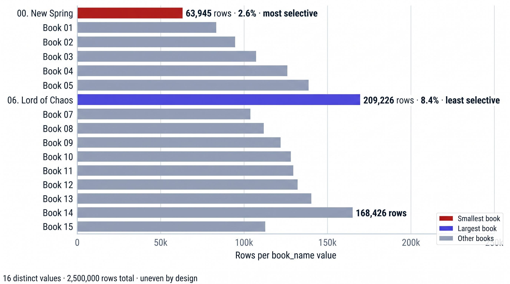
</p>

The benchmark framework is **dataset-agnostic**: you can point it at your own Parquet files and a YAML configuration to check whether your data and filters hit the traps described here. For full dataset schemas and bring-your-own-dataset instructions, see [DATASET.md](doc/DATASET.md).

---

## The Benchmark

Before running retrieval benchmarks, the data must be ingested and indexed. Data ingestion uses PostgreSQL's `COPY` command with binary format via `psycopg3`, which achieves 10 to 50x faster throughput than standard `INSERT` statements; the full 2.5 million row insert completed in **19 minutes** (2,203 rows per second, streamed from Parquet in 100,000-row chunks and written in 5,000-row `COPY` batches). Three indexes are then created on the table: an **HNSW index** on the embedding column for approximate nearest neighbor search (`m = 16`, `ef_construction = 64`), a **B-tree expression index** on `metadata->>'book_name'` for filtered search, and a **GIN index** on `to_tsvector('english', content)` for full-text search. The HNSW index build on 2.5 million 1,536-dimensional vectors took **96 minutes**; the GIN and B-tree indexes took 24 seconds and 1 second.

The last step before the queries is easy to overlook: `ANALYZE wot_chunks_2_5m`, which refreshes the statistics PostgreSQL's planner uses to choose between execution plans. It turned out to be the most consequential step in this whole investigation, so I ran the retrieval benchmark **twice on the same data, indexes and settings**: once without that step, which is the state an ordinary load leaves behind, and once with it. The [concepts section](#table-statistics-how-the-planner-guesses-row-counts) explains why it matters.

<p align="center">
  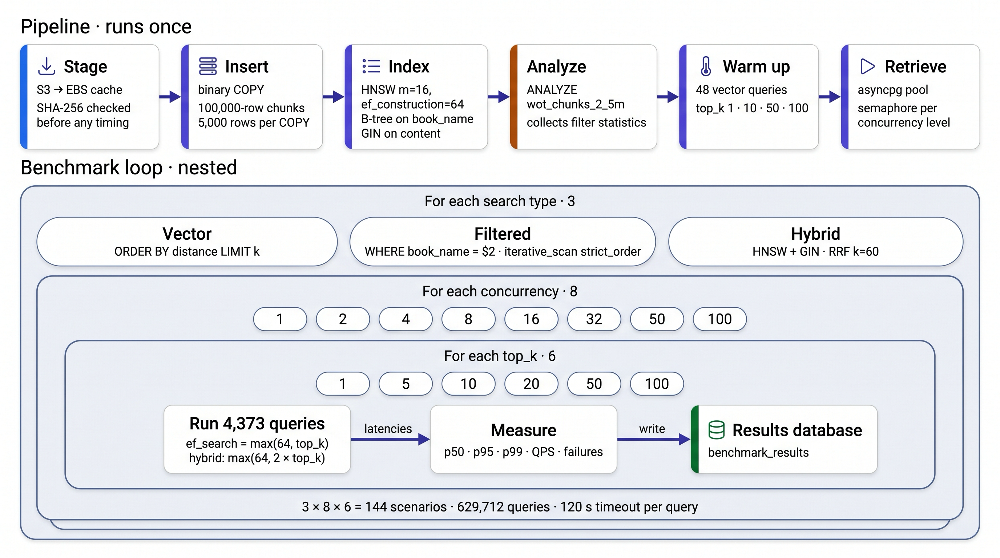
</p>

**Benchmark scripts** (`src/pgvector/`):

- [**01_insert_benchmark_copy.py**](src/pgvector/01_insert_benchmark_copy.py): Bulk data ingestion using PostgreSQL's binary `COPY` protocol via psycopg3. Sets up the database table (`CREATE TABLE` with `content text`, `metadata jsonb`, `embedding vector(1536)`), loads Parquet data in configurable chunks, and streams rows to PostgreSQL. This is the recommended insert method for large datasets.
- [**02_create_indexes.py**](src/pgvector/02_create_indexes.py): Creates HNSW, B-tree, and GIN indexes with configurable parameters. Measures and logs index build times to the results database for each index type.
- [**03_retrieval_asyncpg.py**](src/pgvector/03_retrieval_asyncpg.py) — Primary retrieval benchmark using the asyncpg driver. Runs all three search patterns (vector, filtered, hybrid) across configurable concurrency levels and `top_k` values, measuring QPS and latency percentiles (p50, p95, p99). Uses connection pooling with `asyncpg.create_pool()`.
- [**common.py**](src/pgvector/common.py) — Shared configuration module: database connection management, SQL query templates for all three search patterns (vector, filtered, hybrid), environment variable handling, and connection pool sizing.

**Kubernetes Jobs:**

Every benchmark ran as a plain Kubernetes Job in the `benchmarks` namespace, pinned to the benchmark image by digest:

- [**full-study-job.yaml**](infrastructure/aws/full-study-job.yaml) and [**full_study.py**](scripts/aws/full_study.py) — The complete study as one Job: binary `COPY` insert, row-count check, index builds, `ANALYZE`, index validation, then the 144-scenario retrieval matrix. The orchestrator records every phase, setting, image digest and failure in the results database. Submitted with `scripts/aws/deploy.py full`.
- [**retrieval-only-job.yaml**](infrastructure/aws/retrieval-only-job.yaml) — The retrieval matrix alone, against a table that is already loaded and indexed, with the same image, client resources and settings. This is how the run without statistics was executed.
- [**dataset-pvc.yaml**](infrastructure/aws/dataset-pvc.yaml) — PersistentVolumeClaim for the dataset cache populated from S3, mounted read-only into the Jobs.

The retrieval settings are plain environment variables on the Job:

```yaml
# retrieval-only-job.yaml (excerpt)
command: [python, /app/src/pgvector/03_retrieval_asyncpg.py]
env:
  - {name: TABLE_NAME, value: wot_chunks_2_5m}
  - {name: CONCURRENCY_LEVELS, value: "1,2,4,8,16,32,50,100"}
  - {name: TOP_K_VALUES, value: "1,5,10,20,50,100"}
  - {name: BENCHMARK_NUM_QUERIES, value: "4373"}
  - {name: HNSW_EF_SEARCH_MIN, value: "64"}
  - {name: HNSW_ITERATIVE_SCAN, value: strict_order}
```

```bash
# Run the complete study (insert, index, ANALYZE, retrieval) as one Job
export KUBECONFIG="$PWD/.local/kubeconfig"
uv run python scripts/aws/deploy.py full
kubectl -n benchmarks logs -f job/<study-job-name>
```

The retrieval benchmark ([03_retrieval_asyncpg.py](src/pgvector/03_retrieval_asyncpg.py)) tests three search patterns at varying concurrency levels (1, 2, 4, 8, 16, 32, 50, 100 concurrent queries) and `top_k` values (1, 5, 10, 20, 50, 100):

<p align="center">
  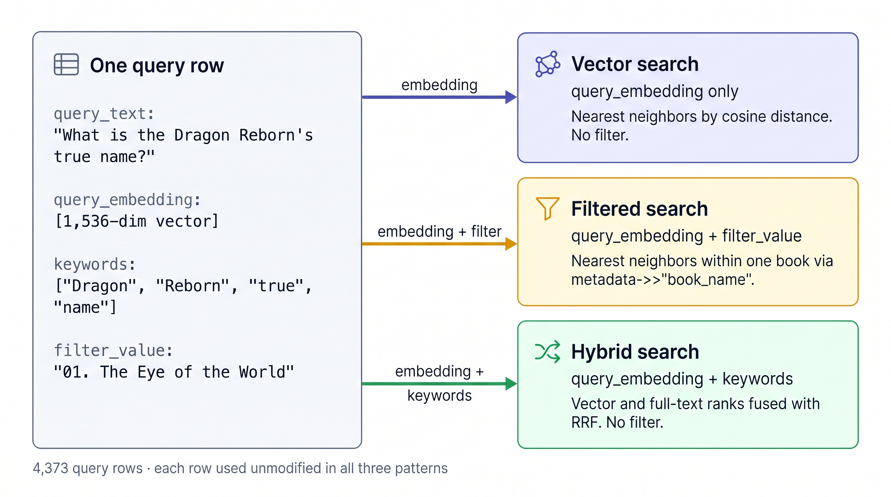
</p>

### 1. Vector Search (Pure ANN)

```python
query = f"""
    SELECT id, 1 - (embedding <=> $1) AS similarity
    FROM {TABLE_NAME}
    ORDER BY embedding <=> $1
    LIMIT {top_k}
"""
await conn.fetch(query, query_embedding)
```

**Key syntax:**

- **`embedding <=> $1`**: pgvector's cosine distance operator. Returns a value in [0, 2]: 0 means identical vectors, 2 means maximally opposite. The `<=>` operator is what signals to PostgreSQL that this is a nearest-neighbor query, triggering HNSW graph traversal instead of a full table scan.
- **`1 - (embedding <=> $1)`**: Converts cosine distance to cosine similarity, ranging from -1 to 1 where 1.0 is identical. This is a cosmetic transformation applied in the `SELECT` — the `ORDER BY` uses the raw distance value, since flipping the sign does not change which row is nearest.
- **`ORDER BY embedding <=> $1 LIMIT k`**: This combination is the key pattern the planner recognizes as a k-nearest-neighbor request. When an HNSW index exists on the `embedding` column, the planner can satisfy this with a graph traversal, visiting only a logarithmic fraction of the table instead of computing distance for every row.

### 2. Filtered Search (Vector + Metadata Filter)

```python
query = f"""
    SELECT id, 1 - (embedding <=> $1) AS similarity
    FROM {TABLE_NAME}
    WHERE metadata->>'{filter_field}' = $2
    ORDER BY embedding <=> $1
    LIMIT {top_k}
"""
await conn.fetch(query, query_embedding, filter_value)
```

**Key syntax:**

- **`metadata->>'book_name'`**: The `->>` operator extracts a text value from a JSONB column. The single-arrow `->` returns a JSONB value; the double-arrow `->>` casts it to text, which is required for equality comparisons against string literals.
- **The interaction between `WHERE` and `ORDER BY embedding <=> $1`** is precisely what creates the filtered search performance problem described in this article. The planner must choose between two strategies: use the HNSW index and discard non-matching results as a post-filter, or use the B-tree metadata index and brute-force the distance computation on the filtered subset. Which one it picks depends on how many rows it _expects_ the filter to match, and that expectation is where things go wrong.

### 3. Hybrid Search (Vector + Full-Text via RRF)

```python
query = f"""
    WITH vector_search AS (
        SELECT id,
               ROW_NUMBER() OVER (ORDER BY embedding <=> $1) as rank,
               1 - (embedding <=> $1) as vector_similarity
        FROM {TABLE_NAME}
        LIMIT {vector_limit}
    ),
    text_search AS (
        SELECT id,
               ROW_NUMBER() OVER (ORDER BY ts_rank(
                   to_tsvector('english', content),
                   plainto_tsquery('english', $2)
               ) DESC) as rank,
               ts_rank(to_tsvector('english', content),
                       plainto_tsquery('english', $2)) as text_score
        FROM {TABLE_NAME}
        WHERE to_tsvector('english', content)
              @@ plainto_tsquery('english', $2)
        LIMIT {vector_limit}
    ),
    rrf_scores AS (
        SELECT COALESCE(v.id, t.id) as id,
               (COALESCE(1.0 / (60 + v.rank), 0.0)
              + COALESCE(1.0 / (60 + t.rank), 0.0)) as rrf_score
        FROM vector_search v
        FULL OUTER JOIN text_search t ON v.id = t.id
    )
    SELECT id, rrf_score as similarity
    FROM rrf_scores
    ORDER BY rrf_score DESC
    LIMIT {top_k}
"""
```

**How Reciprocal Rank Fusion works:**

This query implements a standard two-stage fusion pattern. The two CTEs independently produce ranked candidate lists from different search methods; the third CTE merges them using RRF scoring.

- **`to_tsvector('english', content)`**: Tokenizes the `content` column into searchable lexemes using English language stemming rules. "running" becomes "run", "searched" becomes "search". This normalization allows the index to match inflected forms.
- **`plainto_tsquery('english', $2)`**: Converts a plain text phrase into a `tsquery` — an AND-combination of the stemmed tokens in the query string. The `plain` variant handles arbitrary user input without requiring tsquery syntax.
- **`@@`**: The text search match operator. Returns true if the `tsvector` contains all the tokens in the `tsquery`. This is what the GIN index satisfies efficiently — it answers "which rows contain these tokens" but cannot rank them.
- **`ts_rank(tsvector, tsquery)`**: Computes a relevance score based on term frequency and position within each document. Conceptually similar to TF-IDF. Critically, this score is not stored in the GIN index and must be recomputed by fetching and re-tokenizing every matching row, which is the root cause of the hybrid search bottleneck.
- **`ROW_NUMBER() OVER (ORDER BY ...)`**: Assigns an integer rank (1, 2, 3, ...) to each row within its result set, ordered by either distance or text score. The actual similarity values are discarded; only the ordinal positions matter for RRF.
- **`COALESCE(1.0 / (60 + rank), 0.0)`**: The RRF score formula from Cormack et al. (2009). The constant 60 smooths rank differences near the top of each list — a result ranked 1st contributes 1/61 ≈ 0.0164, while rank 10 contributes 1/70 ≈ 0.0143. This prevents top-ranked results from dominating the fusion score by too wide a margin while still rewarding them over lower-ranked ones.
- **`FULL OUTER JOIN`**: Ensures every candidate from either the vector search or the text search appears in the fused result, even if it was found by only one method. A result exclusive to the vector search will have a `NULL` text rank (handled by `COALESCE(..., 0.0)`), and vice versa.

The complete standalone SQL for all three patterns, with `EXPLAIN ANALYZE` wrappers and parameterized filter experiments, is available in [`scripts/perf_audit_pgvector_2.5m_wot.sql`](scripts/perf_audit_pgvector_2.5m_wot.sql).

The benchmark driver uses Python's `asyncpg` with connection pooling and semaphore-based concurrency control. Each test scenario runs 4,373 queries using real embeddings from the query dataset. HNSW settings are applied per query: `hnsw.ef_search = max(64, top_k)` (hybrid search uses `max(64, 2 × top_k)` for its larger candidate list), and filtered searches enable `hnsw.iterative_scan = strict_order`. Both settings are explained in the next section.

---

## Understanding the Key PostgreSQL Concepts

Before diving into the benchmark results and the performance cliff, it is important to understand the PostgreSQL internals involved. These concepts are essential to grasping why the problem occurs. The section covers the three index types the benchmark uses (HNSW, B-tree and GIN), then how PostgreSQL decides which one to use: the query planner, its cost model, and the table statistics it relies on.

### HNSW Index

HNSW (Hierarchical Navigable Small World) is a graph-based approximate nearest neighbor (ANN) index. pgvector implements it as a PostgreSQL access method, allowing `ORDER BY embedding <=> $1 LIMIT k` queries to be answered by traversing a prebuilt graph instead of scanning every row in the table.

The core idea is a multi-layer graph that works a lot like zooming in on a map. Each vector in your table becomes a "node" in this graph, connected to its nearest neighbors by edges.

- **The top layer** contains only a tiny, random subset of nodes (like major cities on a map) connected by long "highways". This allows the search to quickly jump across the vector space.
- **The middle layers** contain progressively more nodes.
- **The bottom layer (Layer 0)** contains absolutely every vector in the table, connected by short, dense local roads.

This layered structure enables a fast "coarse-to-fine" search:

<p align="center">
  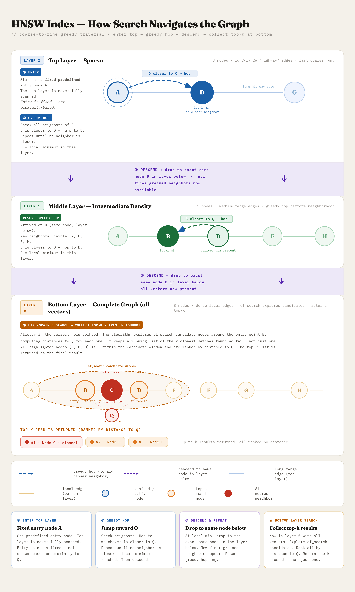
</p>

> For the full interactive version of this diagram, see [doc/diagrams/hnsw-graph.html](doc/diagrams/hnsw-graph.html).

**How the search algorithm navigates this graph:**

1. **Enter the top layer**: The search starts at a single, predefined entry node in the topmost layer. It does not scan all nodes in this layer.
2. **Greedy search**: At the current node, the algorithm calculates the distance between the query vector and all of the node's connected neighbors. If one of those neighbors is closer to the query than the current node is, the algorithm jumps to that neighbor. It repeats this "greedy" hopping process until it reaches a node where _none_ of the connected neighbors are closer to the query.
3. **Descend**: Once it can't get any closer at the current layer, it drops down to the **exact same node** in the layer below. Because the layer below has more nodes and connections, the node it just dropped into now has new, finer-grained neighbors to explore. It resumes the greedy search from there.
4. **Bottom layer search**: By the time it descends to Layer 0 (which contains all data), it is already in the correct "neighborhood". It explores this local area thoroughly, keeping a list of the best `k` candidates it finds.

The total number of distance comparisons is logarithmic in the dataset size, which is what makes HNSW dramatically faster than a sequential scan.

**Key parameters:**

- **`m`** (build-time, default: 16) — The maximum number of edges (connections) a single node can have to other nodes in a layer. At search time, each greedy hop evaluates exactly `m` neighbors to decide where to move next, so this parameter directly shapes both graph quality and search cost.
  - **Quality (recall):** Higher `m` means each node is connected to more neighbors, making the graph more densely interconnected. This reduces the chance of "dead ends" where the greedy search gets stuck in a local minimum — with more edges, there are more paths to the true nearest neighbors. Increasing `m` from 16 to 48 can noticeably improve recall, especially for high-dimensional data (like our 1,536-dim vectors) where the graph needs richer connectivity to capture the geometry of the space.
  - **Performance:** Higher `m` increases both build time and search latency. During construction, the algorithm must evaluate and maintain more connections per node. During search, every hop computes distances to all `m` neighbors, so doubling `m` roughly doubles the per-hop cost. Memory usage also scales linearly with `m`, since each node stores `m` edge pointers per layer.
  - Our benchmark uses `m = 16` (the pgvector default), which provides a practical balance for most workloads.

<p align="center">
  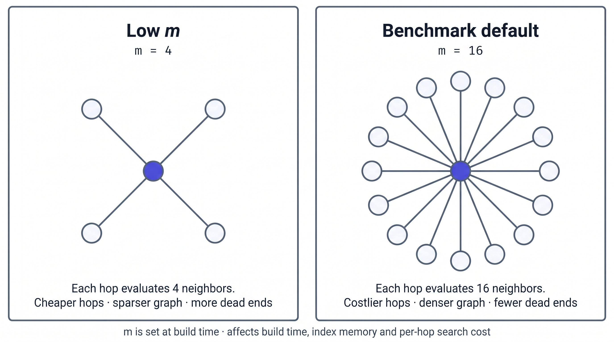
</p>

- **`ef_construction`** (build-time, default: 64) — Controls the quality of the edges built into the graph. When a new vector is inserted, the algorithm must decide which existing nodes to connect it to. It does this by running a search (similar to the greedy traversal described above) to find the best neighbors for the new node. `ef_construction` is the size of the candidate list used during that neighbor search: a larger list means the algorithm evaluates more potential neighbors before selecting the best `m` to create edges to.
  - **Quality (recall):** This is the single most impactful parameter for index quality. A larger `ef_construction` means the build-time search explores more of the graph when deciding who to connect a new node to, so each node ends up linked to its _truly_ closest neighbors rather than merely the first `m` close-enough nodes found. The result is a higher-quality graph where search paths converge more reliably to the correct answer. Increasing `ef_construction` from 64 to 256 can significantly improve recall, especially for large datasets where the greedy build-time search is more likely to miss optimal connections with a small candidate list.
  - **Performance:** Higher `ef_construction` increases index build time proportionally (more distance computations per insertion) but has **zero effect on search latency** — it is purely a build-time parameter. Once the index is built, the graph structure is fixed and search speed depends only on `m` and `ef_search`. This makes `ef_construction` a "free quality knob" — you pay the cost once during index creation and benefit from better recall on every subsequent query.
  - Our benchmark uses `ef_construction = 64` (the pgvector default). For production systems where index build time is acceptable (our 2.5M-vector build took 96 minutes), values of 128–256 are common.

<p align="center">
  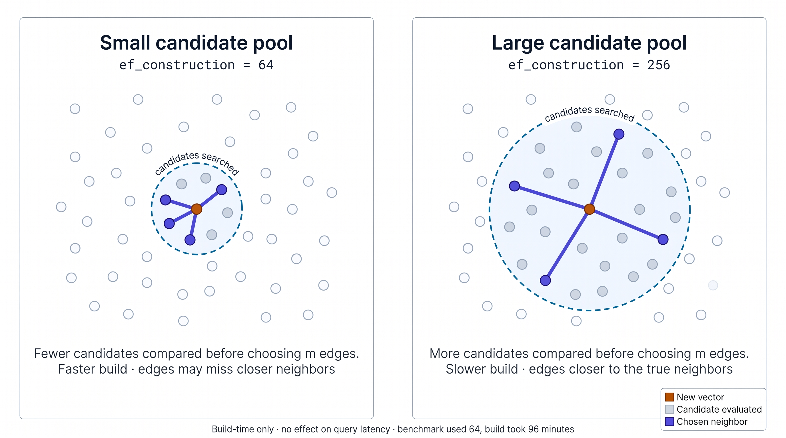
</p>

- **`ef_search`** (query-time, default: 40) — Controls how thoroughly the algorithm explores the bottom layer (Layer 0) during a query. Recall from step 4 above: once the search descends to Layer 0, it explores the local neighborhood to collect the best candidates. `ef_search` is the size of the priority queue that holds these candidates. As the algorithm hops from node to node in Layer 0, it adds each visited neighbor to this queue, keeping only the closest `ef_search` candidates.
  - **Quality (recall):** This is the primary runtime knob for recall. A larger queue means the search casts a wider net — it continues exploring outward from the query vector for longer, visiting more nodes before concluding that it has found the best results. `ef_search = 40` (the default) terminates quickly but may miss true nearest neighbors in dense regions of the vector space. `ef_search = 400` explores roughly 10x more of the graph, giving near-perfect recall. For most production workloads, values between 100–200 provide a strong recall/speed balance.
  - **Performance:** Search latency scales roughly linearly with `ef_search`, since each additional candidate in the queue requires distance computations against its neighbors. Doubling `ef_search` approximately doubles the number of nodes visited and distance computations performed, which directly increases query time. At high concurrency, this cost compounds — each concurrent query does more work, increasing CPU load and reducing overall QPS.
  - Must be ≥ `top_k` (you cannot return more results than the queue can hold). Can be tuned per-session without rebuilding the index: `SET hnsw.ef_search = 100`.

<p align="center">
  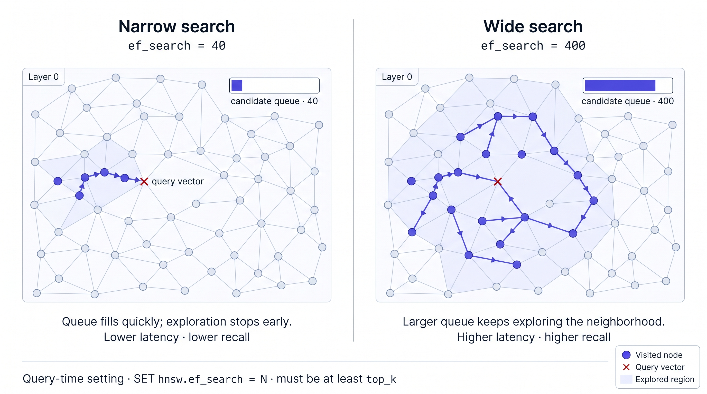
</p>

**The critical detail for filtered search:**

When PostgreSQL uses the HNSW index for a query with a `WHERE` clause (e.g., `WHERE metadata->>'book_name' = 'The Eye of the World'`), it does not pre-filter the graph. Instead, the index traversal finds the nearest vectors first, and applies the filter as a **post-filter**, discarding rows that do not match. If a candidate is discarded, the search is forced to keep exploring further outward into the graph to find replacement results.

To understand why this breaks down, consider a concrete example. The smallest book in our dataset — "00. New Spring" — accounts for 63,945 rows out of 2.5 million, roughly **2.6%** of the table. When you run a filtered query like `WHERE metadata->>'book_name' = '00. New Spring' ORDER BY embedding <=> $1 LIMIT 50`, the HNSW index does not know about the filter. It simply traverses the graph and returns vectors in order of distance from the query vector, regardless of which book they belong to.

If the vectors of "New Spring" were spread evenly through the vector space, the index would need to retrieve, on average, about **38 candidates** before it finds a single one that passes the filter ($\frac{1}{0.026} \approx 38.4$). The other 37 are discarded. To accumulate 50 valid results after filtering, the index would therefore need to traverse and evaluate roughly $50 \times 38.4 \approx$ **1,920 candidate vectors** from the graph — scanning through 1,920 nearest neighbors just to find 50 that belong to the correct book. In practice a query about one book usually lands near that book's chunks, so the real number varies from query to query, but the principle holds: the rarer the filter value, the further the index must search.

<p align="center">
  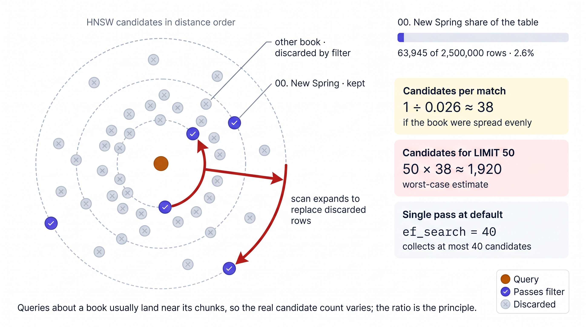
</p>

This post-filter behavior creates two separate problems. The first is an **index-level completeness problem**: with the default `ef_search = 40`, the HNSW index performs a single traversal, collects at most 40 candidates, and stops. If a selective filter discards most of them, the index simply cannot produce enough matching rows, and the query quietly returns fewer rows than `LIMIT` asked for. The second is a **planner-level estimation problem**: PostgreSQL's query planner has to estimate how much work the HNSW path will do before running it, and that estimate depends on how many rows the planner _believes_ match the filter. When that belief is badly wrong, the planner concludes that a brute-force plan is cheaper and abandons the HNSW index entirely. That planner decision — not the index's scanning limitation — produces the performance cliff investigated in this article. The [table statistics](#table-statistics-how-the-planner-guesses-row-counts) section below explains where the planner's belief comes from.

**Iterative index scans (pgvector 0.8.0+):**

pgvector 0.8.0 (released October 2024) introduced **iterative index scans**, a feature that addresses the first problem: the index-level completeness limitation. Without iterative scan, the HNSW index performs a single pass: it traverses the graph, collects up to `ef_search` candidates (default 40), and returns them. If a `WHERE` clause filters most of those candidates away, you get fewer results than requested. Iterative scan does **not** address the second problem — the planner's choice of plan — because the planner makes that choice before any index is scanned.

Iterative scan allows the HNSW index to **resume scanning** when the initial batch of candidates is insufficient. Instead of discarding the traversal state after the first pass, the index preserves a priority queue of "discarded" candidates — nodes that were explored but not yet returned. When PostgreSQL needs more rows (because post-filtering eliminated too many), the index picks up where it left off, expanding outward from those discarded candidates to explore additional regions of the graph. This process repeats in batches of `ef_search` candidates until enough filtered results are found, or until a safety limit is reached (`hnsw.max_scan_tuples`, default 20,000).

This is conceptually similar to pagination through the graph: rather than a single fixed-size scan, iterative mode turns the HNSW index into a streaming source that can produce as many candidates as needed.

Iterative scan has three modes, controlled by the `hnsw.iterative_scan` GUC (Grand Unified Configuration — PostgreSQL's term for a runtime configuration parameter, i.e., a setting you can change with `SET` or in `postgresql.conf`):

- **`off`** (default) — The original behavior. A single HNSW traversal collects up to `ef_search` candidates and stops. If filtering removes most of them, you get fewer results than `LIMIT` requested. The diagnostic examples in this article use this mode unless they say otherwise; the benchmark enables `strict_order` for filtered queries.
- **`strict_order`** — Enables iterative rescanning with the guarantee that results are returned in **exact distance order**. Each resumed batch is merged with previously seen results, and the index only emits a row when it can prove no closer unseen row exists. This provides the same ordering guarantee as a non-iterative scan, but may do more work to maintain that invariant.
- **`relaxed_order`** — Enables iterative rescanning but allows results to be **slightly out of order** by distance. This is faster than `strict_order` because the index can emit rows from resumed batches without waiting to confirm global ordering. The results are still approximate nearest neighbors, but two adjacent rows might be swapped in distance ranking. For most practical applications (RAG retrieval, recommendation systems), this is indistinguishable from strict ordering. This mode provides the best recall-to-performance ratio for filtered queries.

<p align="center">
  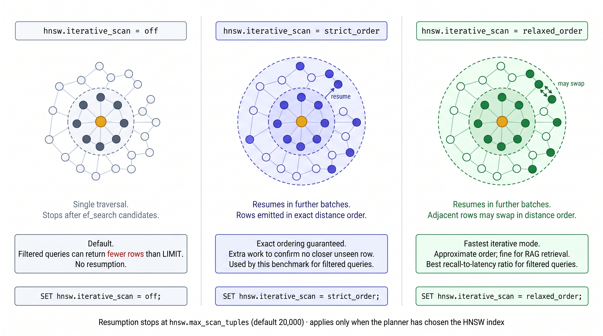
</p>

Usage:

```sql
-- Enable iterative scan for the session
SET hnsw.iterative_scan = strict_order;
-- or
SET hnsw.iterative_scan = relaxed_order;

-- Control how far the scan can go (default: 20,000 tuples)
SET hnsw.max_scan_tuples = 20000;

-- Control memory usage as a multiplier of work_mem (default: 1)
SET hnsw.scan_mem_multiplier = 2;
```

**To summarize**: Iterative scan gives the HNSW index the mechanical ability to keep scanning until enough filtered results are found. But the planner decides which plan to run _before_ the index is ever consulted. If its estimates make a brute-force bitmap scan look cheaper than the HNSW path, it chooses brute force regardless of whether iterative scan is enabled. Iterative scan only activates when the planner actually selects the HNSW index — which, as the investigation shows, is exactly what stops happening above a certain `LIMIT` when the planner's estimates are wrong.

To recap the two problems stacked on top of each other:

1. **The index problem** (fixed by iterative scan): HNSW could not keep scanning beyond `ef_search` to find enough filtered results.
2. **The planner problem** (fixed by accurate statistics): without statistics for the filter column, the planner underestimates how many rows match, which makes brute force look cheaper than HNSW at moderate `top_k` values — before iterative scan ever gets a chance to run.

<p align="center">
  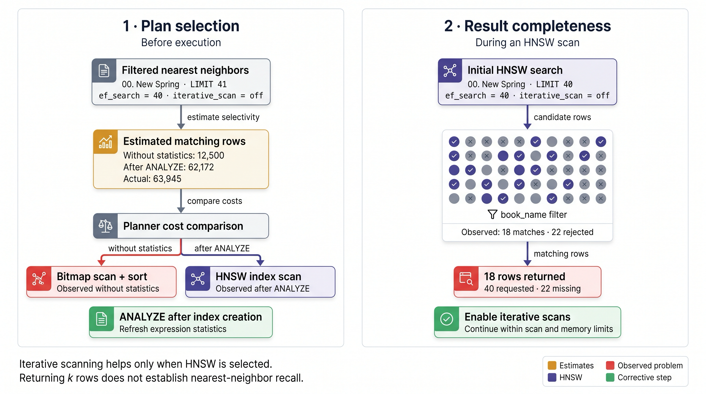
</p>

### B-Tree Index and Bitmap Heap Scan

When a filtered vector search query combines a `WHERE` clause with `ORDER BY embedding <=> $1 LIMIT N`, the query planner may abandon the HNSW index at higher `top_k` values and switch to an alternative plan built around two things working together: a B-tree index to find matching rows, and a Bitmap Heap Scan to fetch them from the table. In the benchmark run without statistics, this switch happened at exactly `top_k = 41` with the default `hnsw.ef_search = 40` — and at the same threshold for every filter in the dataset, regardless of how many rows matched (2.6% to 8.4% of the table). The investigation explains why the threshold does not depend on the filter. First, it helps to walk through what this alternative plan does, using the actual data.

The diagram below shows the complete three-phase plan that PostgreSQL executes when it abandons the HNSW index. Follow it top to bottom as we walk through each phase.

<p align="center">
  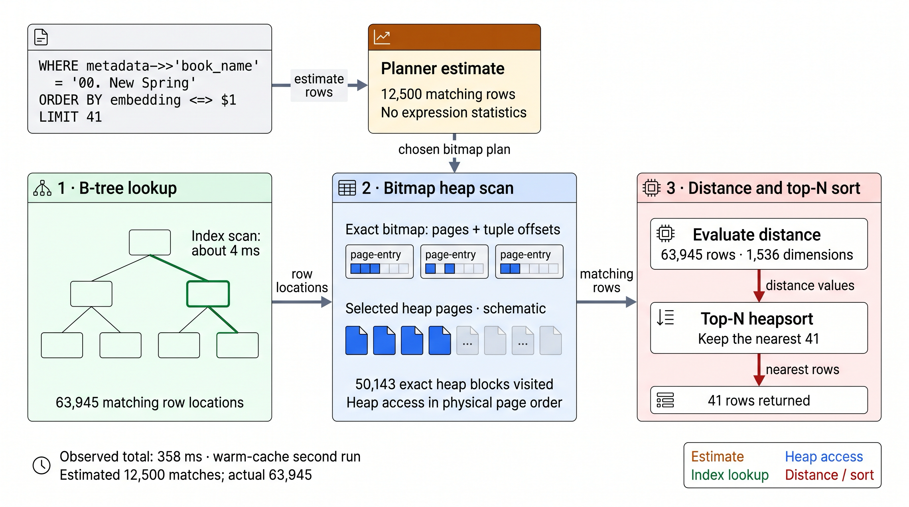
</p>

#### Phase 1: B-Tree Index Traversal (~4 ms)

The expression index `CREATE INDEX ON wot_chunks_2_5m ((metadata->>'book_name'))` stores one entry for every row in the 2.5 million row table — specifically, the `book_name` value extracted from that row, plus the physical address of where that row lives on disk. PostgreSQL calls this address a `ctid` (tuple ID) — it means "go to disk page 4021, and inside that page, the row is in slot 3." The B-tree organises all of these entries into a three-level structure, visible in the top section of the diagram.

**Leaf nodes** sit at the bottom of the tree. Each leaf is a single 8 KB disk page holding a sorted list of `(book_name, ctid)` pairs. All 63,945 entries for `'00. New Spring'` live here, spanning a few hundred leaf pages. Crucially, leaf nodes are linked to each other in a chain — once PostgreSQL reaches the first matching leaf, it reads forward through consecutive leaf pages without navigating the tree again.

**Branch nodes** sit above the leaves. They do not store any row addresses — only a few key values that act as signposts, telling the search which subtree to descend into. As shown in the diagram, a branch node containing `["Eye of the World", "Fires of Heaven"]` directs the search left, middle, or right based on alphabetical comparison.

**The root node** is the single entry point at the top. Every search begins here. For `'00. New Spring'`, the root's keys (`"Lord of Chaos"`, `"The Shadow Rising"`) immediately direct the search left, the branch node narrows further, and within 3 to 4 node hops the search arrives at the first matching leaf. From there it reads forward through the linked leaf chain, collecting ctids until the book name changes.

The result: 63,945 physical row addresses collected in about 4 ms, regardless of the table having 2.5 million rows.

#### Phase 2: Bitmap Heap Scan

Now PostgreSQL has 63,945 ctids — but these addresses are scattered across the table. The rows for `'00. New Spring'` were not inserted together; the table stores all books interleaved. A single disk page might contain one `'00. New Spring'` row alongside several `'Lord of Chaos'` rows and a handful of `'The Eye of the World'` rows. The 63,945 matching rows end up spread across 50,143 different physical pages of the table.

Following these addresses one by one would cause chaotic random disk I/O — fetching page 71, then jumping to page 18004, then back to page 312. This is exactly the problem the Bitmap Heap Scan solves, as shown in the middle section of the diagram.

PostgreSQL builds a small in-memory bitmap — one bit per page in the table. The table spans 143,896 pages, so the bitmap is about 144,000 bits (18 KB). It marks a 1 for every page that contains at least one matching row, and a 0 for everything else. At this point, nothing has been fetched yet.

Then PostgreSQL reads through this bitmap from start to finish. Pages marked 0 are skipped entirely. Pages marked 1 are fetched, in physical order. This converts 63,945 random lookups into an ordered pass over 50,143 pages. Each page is loaded exactly once.

Once a marked page is loaded into memory, PostgreSQL checks which rows inside it actually match the filter — because a single page can contain rows from multiple books. Not every row on a marked page belongs to `'00. New Spring'`. This is the "Recheck Condition" step visible in the `EXPLAIN ANALYZE` output. The ~94,000 pages containing no matching rows are never loaded at all.

#### Phase 3: Brute-Force Distance Calculation (~350 ms)

The cost is in what the planner scheduled next, shown in the red section at the bottom of the diagram.

Those 63,945 fetched rows still need to be sorted by vector distance to answer `ORDER BY embedding <=> $1 LIMIT 41`. That means computing cosine distance across 1,536 dimensions on every single one of them — 63,945 brute-force distance calculations, roughly 98 million floating-point operations, just to find the closest 41. Each 1,536-dimension embedding is about 6 KB, larger than PostgreSQL stores inside a table page, so it lives in a separate TOAST table and must be fetched from there too: the plan touched 305,980 buffer pages in total.

With everything already in memory, phases 2 and 3 together took about 350 ms for New Spring and 1.1 seconds for the largest book. Compare that with 1.5 ms for the HNSW plan of the same query at `LIMIT 40`. When those pages are not cached, the plan must also read them from disk, so its cost then depends on the storage's IOPS and throughput as well: the larger the matching set, the more pages, and the more the disk dominates.

On paper, the planner rated this plan as cheap. pgvector declares its distance functions without a custom cost, so PostgreSQL prices each distance computation at the default operator cost (`cpu_operator_cost = 0.0025`) — the same as comparing two integers. But the much larger error in its estimate was not the price of one distance. It was the number of distances: the planner expected the filter to match 12,500 rows, and it matched 63,945. The investigation section shows where that 12,500 came from.

### GIN Index and Full-Text Search

The expression index `CREATE INDEX ON wot_chunks_2_5m USING gin (to_tsvector('english', content))` builds a GIN (Generalized Inverted Index) for full-text search. To understand why this index has a fundamental limitation at query time, it helps to see exactly how it is built — and what it does and does not store.

<p align="center">
  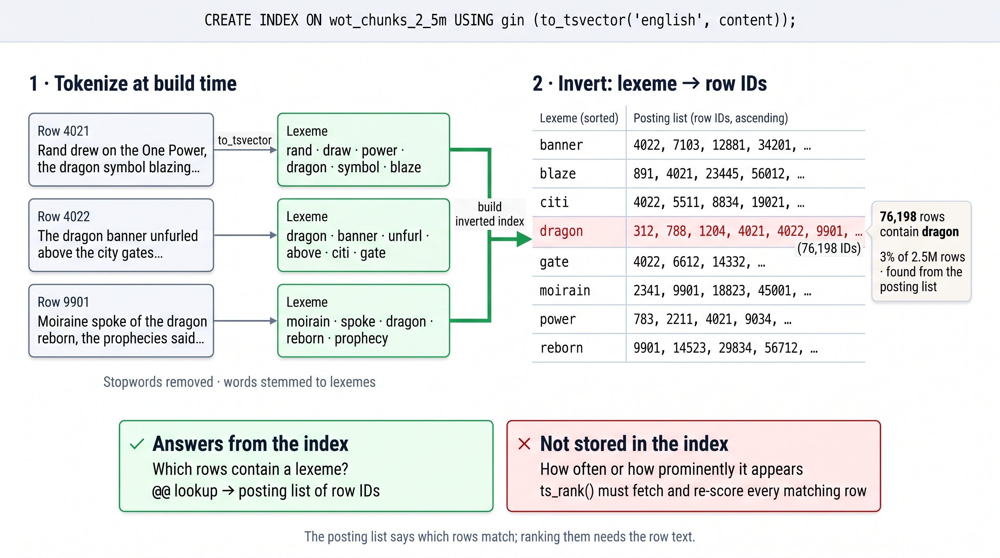
</p>

**Step 1: Tokenization at index build time**

When the index is built, PostgreSQL runs `to_tsvector('english', content)` on every row. As the diagram shows, this does two things to the raw text. First, it strips common words like "the", "of", "on" — called stopwords — because they carry no search value. Second, it reduces remaining words to their root form through stemming: "blazing" becomes `blaze`, "unfurled" becomes `unfurl`, "dragons" becomes `dragon`. The result is a compact set of tokens called lexemes.

So a chunk like:

> _"Rand drew on the One Power, the dragon symbol blazing..."_

becomes: `rand · draw · power · dragon · symbol · blaze`

And another chunk like:

> _"Moiraine spoke of the dragon reborn, the prophecies said..."_

becomes: `moirain · spoke · dragon · reborn · prophecy`

Notice that "dragon" appears as the same lexeme in both rows, even though the original text used different forms of the word. This is how a search for "dragons" matches all of them.

**Step 2: Building the inverted index**

Once every row is tokenised, the GIN index flips the relationship. Instead of storing "row → list of words", it builds the opposite mapping: "word → list of rows." As the diagram shows, the result is a sorted table of lexemes, and next to each lexeme sits a posting list — the full list of row IDs that contain that word:

| Lexeme   | Posting List                                             |
| -------- | -------------------------------------------------------- |
| `banner` | 4022, 7103, 12881, 34201, ...                            |
| `blaze`  | 4021, 891, 23445, 56012, ...                             |
| `dragon` | 4021, 4022, 9901, 312, 788, ... _(76,198 row IDs total)_ |
| `reborn` | 9901, 14523, 29834, 56712, ...                           |

This is what "inverted" means — the index is keyed by word, not by row. The lexemes are stored in sorted alphabetical order, so looking up any word is an O(log n) binary search into this list.

**What the GIN index can and cannot do**

When a query arrives with `WHERE to_tsvector('english', content) @@ plainto_tsquery('english', 'dragon')`, PostgreSQL jumps directly to the `dragon` entry and retrieves its posting list of 76,198 row IDs in milliseconds. As the bottom-left of the diagram notes, this is what GIN does instantly and accurately.

The problem is ranking. The posting list stores only _which_ rows contain the word — not _how often_ or _how prominently_ it appears in each row. But `ts_rank()` needs exactly that frequency information to score relevance. Since the GIN index simply does not store it, PostgreSQL has no choice but to:

1. Use the GIN index to get all 76,198 row IDs matching `'dragon'`
2. Fetch every one of those rows from the table
3. Re-tokenise the `content` column of each row at query time to compute `ts_rank()`
4. Sort all of the scored rows by rank
5. Return the top N

As the bottom-right of the diagram states: `ts_rank()` depends on term frequency within each document — information not stored in the GIN index. This forces the "fetch all, score all, sort all" pattern that makes the full-text component of hybrid search the slow half, as we will see in the hybrid search investigation later.

### Putting It All Together: The Index Footprint

To verify the indexing strategy and understand the disk footprint of each index, querying the `pg_indexes` and `pg_class` system catalogs provides a clear breakdown of the indexes created on our `wot_chunks_2_5m` table. As seen in the output below, there are four distinct indexes, each serving a specific query pattern we discussed above:

<p align="center">
  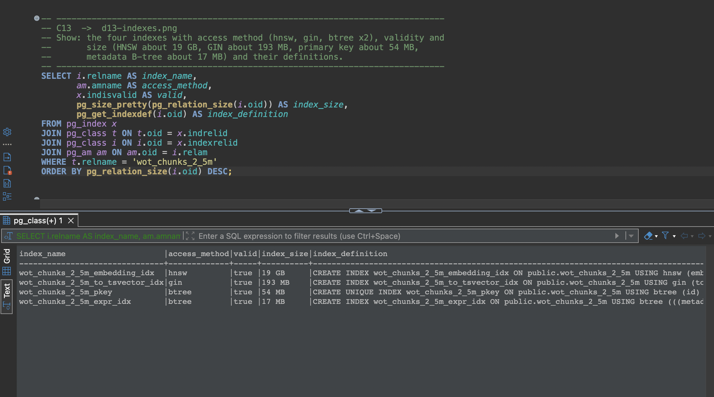
</p>

1. **`wot_chunks_2_5m_embedding_idx` (HNSW Index)**: This is pgvector's Hierarchical Navigable Small World index used for approximate nearest neighbor (ANN) search on the vector embeddings. It is by far the largest index (~19 GB) because it stores a complex, multi-layered graph structure (`m=16`, `ef_construction=64`) to enable rapid vector similarity searches using cosine distance (`vector_cosine_ops`).
2. **`wot_chunks_2_5m_to_tsvector_idx` (GIN Index)**: The Generalized Inverted Index (GIN) is used for full-text search. It maps tokenised English words (lexemes) to the rows that contain them, allowing rapid keyword matching against the text `content` during hybrid search (~193 MB).
3. **`wot_chunks_2_5m_pkey` (B-Tree Index)**: The standard default PostgreSQL index built automatically for the primary key (`id`). It guarantees row uniqueness and enables fast exact-match lookups (~54 MB).
4. **`wot_chunks_2_5m_expr_idx` (B-Tree Expression Index)**: This index accelerates metadata filtering. Instead of querying the raw JSONB column directly, it creates a B-tree over the extracted text values of `metadata->>'book_name'`, allowing PostgreSQL to instantly find chunks originating from a specific book (~17 MB).

### The Query Planner and Cost Model

PostgreSQL's query planner (also called the optimizer) evaluates multiple possible execution strategies for every query and picks the one with the lowest estimated cost. The planner assigns numeric cost estimates to each plan node based on configurable parameters:

- `seq_page_cost`: Cost of reading a page sequentially (default: 1.0)
- `random_page_cost`: Cost of reading a random page (default: 4.0, we set 1.1 for SSD)
- `cpu_tuple_cost`: Cost per row for processing (default: 0.01)
- `cpu_operator_cost`: Cost per operator invocation (default: 0.0025)

These costs are in arbitrary units but are internally consistent. The planner computes the total estimated cost for each possible plan and picks the cheapest one.

Two inputs drive every one of those estimates: the price of each step, and **how many rows each step will process**. The price side has a known weakness for vector search: the cost of the `<=>` (cosine distance) operator on 1,536-dimensional vectors is treated the same as **any other operator** (`cpu_operator_cost = 0.0025`). In reality, computing cosine distance on 1,536-dimensional float32 vectors requires 1,536 floating-point multiplications and additions per invocation, making it far more expensive than comparing two scalar values. The row-count side comes from table statistics, covered next, and in this investigation it turned out to be the input that went badly wrong.

For the HNSW path, pgvector supplies its own cost estimate. It estimates the work of a complete graph scan from the number of rows in the table, `m` and `ef_search`, then the planner scales that cost down by how many of the expected matching rows a `LIMIT` needs. The fewer rows the planner expects to pass the filter, the more of the graph it assumes must be scanned to fill the `LIMIT`, and the more expensive HNSW looks.

<p align="center">
  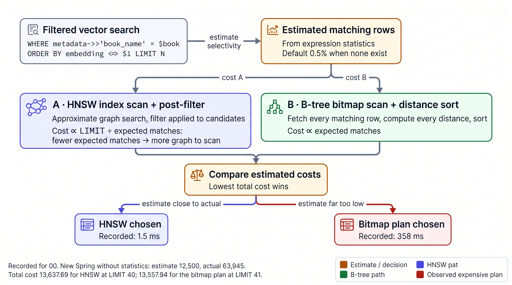
</p>

### Table Statistics: How the Planner Guesses Row Counts

The planner never counts rows while planning; that would take longer than many queries. Instead it reads **statistics**: a compact summary of each column's data, stored in the `pg_statistic` catalog and readable through the `pg_stats` view. For a column like `book_name`, the summary includes the number of distinct values, the most common values and how often each occurs (for example, "06. Lord of Chaos" in 8.4% of rows), and a histogram of the rest.

**`ANALYZE`** builds these statistics. It reads a random sample of the table (30,000 rows with default settings), summarises every column, and saves the result. PostgreSQL's autovacuum daemon also runs `ANALYZE` on its own, but only after a table has changed enough: by default, after about 10% of its rows have been inserted, updated or deleted since the last analysis.

There is a catch for JSONB metadata. Statistics are kept per column, and `metadata` is a single JSONB column; the planner cannot see the distribution of `book_name` inside it. The one exception is an **expression index**: when an index exists on `metadata->>'book_name'`, `ANALYZE` also collects statistics for that expression, exactly as if it were a column. They appear in `pg_stats` under the index's name.

When there are no statistics for a filter, the planner falls back to fixed default guesses. For an equality condition such as `metadata->>'book_name' = '00. New Spring'`, the default is **0.5% of the table**: 12,500 rows out of 2.5 million, for every book, whatever its real size.

Now look at the ordinary way a vector table is loaded:

1. **Bulk insert** 2.5 million rows. Partway through, autovacuum notices the new rows and runs `ANALYZE` on its own. No expression index exists yet, so nothing is collected for `book_name`.
2. **Create the indexes**, including the B-tree on `metadata->>'book_name'`. `CREATE INDEX` builds the index but collects no statistics.
3. **Start serving queries.** Queries only read the table, so autovacuum never sees a reason to analyze it again.

The table can stay in this state indefinitely. On the EKS cluster, `pg_stat_user_tables` showed exactly that sequence: autovacuum analyzed the table at 05:07 UTC during the insert, and the indexes finished at 06:47 UTC. Only an explicit `ANALYZE` after step 2 gives the planner real numbers.

<p align="center">
  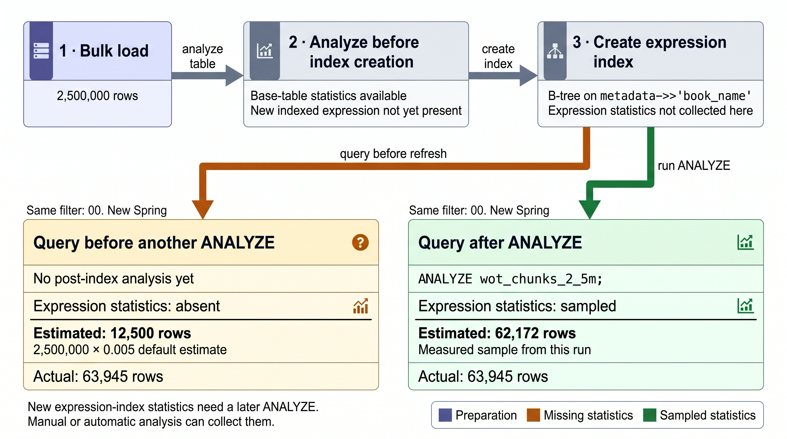
</p>

You can check any table in a few seconds:

```sql
-- Statistics for an expression index appear under the index name.
-- No rows here means the planner is guessing for that filter.
SELECT attname, n_distinct, most_common_vals
FROM pg_stats
WHERE tablename = 'wot_chunks_2_5m_expr_idx';
```

---

## The Problem: Filtered Search Falls Off a Cliff

This section shows the benchmark in the state an ordinary load leaves behind: data inserted, indexes created, no `ANALYZE` afterwards. [The Fix](#the-fix-collect-statistics-after-building-indexes) shows the same benchmark after `ANALYZE`.

Pure vector search worked well across all `top_k` values. But the other two search patterns revealed problems. Filtered search showed a dramatic performance degradation at `top_k >= 50`, and hybrid search, while stable across `top_k` values, was consistently about 3x slower than pure vector search at every data point:

### Benchmark Results Without Statistics: pgvector CNPG (2.5M Vectors)

<p align="center">
  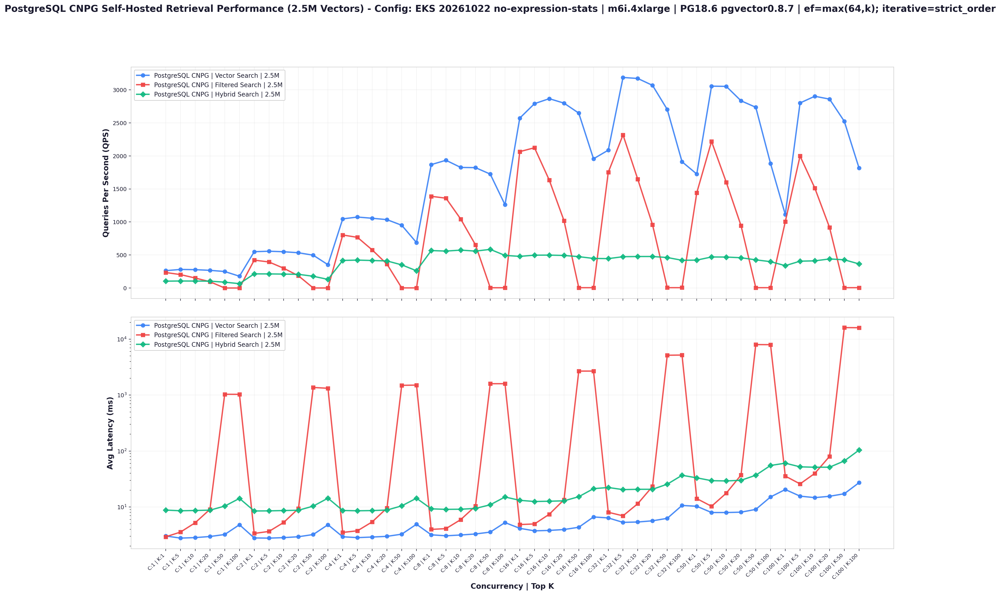
</p>

**How to read this chart:** The x-axis uses a composite notation `C:N | K:N`, where **C** is the concurrency level (number of parallel queries) and **K** is the `top_k` value (the `LIMIT` in the SQL query). For example, `C:8 | K:20` means 8 concurrent queries each requesting the top 20 nearest neighbors. The top panel shows throughput (Queries Per Second), while the bottom panel shows average latency on a logarithmic scale. Three search types are plotted: **Vector Search** (blue), **Filtered Search** (red), and **Hybrid Search** (green).

The pattern is stark. Look at the red Filtered Search line: it tracks closely with Vector Search through the low `top_k` range, then suddenly collapses. Filtered search at `C:50 | K:20`: **37 ms** average, **944 QPS**. The same filtered search at `C:50 | K:50`: **7,999 ms** average, **5.95 QPS**. That is a **215x latency increase** from one step in the `top_k` axis.

Vector search (blue) shows no such cliff — its QPS and latency scale smoothly across all `top_k` values. Hybrid search (green) also has no `top_k`-dependent cliff, but notice something else: even at `C:1 | K:10`, hybrid search averages **8.66 ms** compared to vector search's **2.84 ms**. This consistent gap is a separate problem that we will investigate after the filtered search deep-dive.

The latency line only shows the queries that finished. Many did not. Each query in the benchmark has a budget of 160 seconds from the moment its scenario submits it, including the time it waits for a free concurrency slot. In the `top_k = 50` and `top_k = 100` filtered scenarios, the slow plan made the queue so long that most queries ran out of budget. The benchmark logs were filled with:

```json
{
  "idx": 155,
  "timeout": 160.0,
  "event": "query_timed_out",
  "level": "warning"
}
```

Across the 16 filtered scenarios at `top_k = 50` and `top_k = 100`, **59,133 of 69,968 queries (85%) timed out**. Throughput flattened at about **6 queries per second whatever the concurrency**, because every query now computed tens of thousands of distances and the database ran out of CPU. Every other scenario in the matrix — vector search, hybrid search, and filtered search at `top_k ≤ 20` — completed all of its queries.

This was not a concurrency issue. Even a **single client** at `C:1 | K:50` averaged **1,035 ms** per query, against **9.08 ms** at `K:20`, and completed only 154 of its 4,373 queries within the budget. Something fundamental had changed in how PostgreSQL executed the query.

<p align="center">
  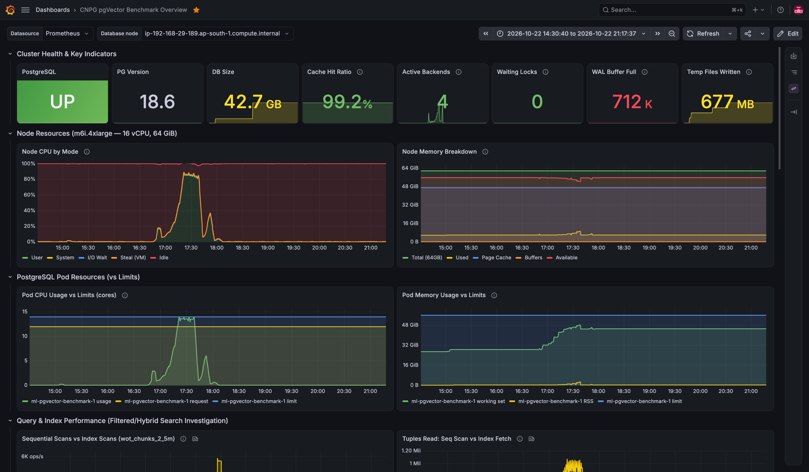
</p>

---

## The Investigation: EXPLAIN ANALYZE Reveals the Truth

To understand what was happening, I wrote a diagnostic script that runs the exact filtered search query at different `LIMIT` values using PostgreSQL's `EXPLAIN (ANALYZE, BUFFERS)`. This shows the actual execution plan the query planner chose and the real runtime statistics. Every experiment in this section uses one fixed query vector, so adjacent `LIMIT` values are directly comparable, and runs each query twice, reporting the second run so that both plans are measured with a warm cache. The script is [`scripts/diagnose_statistics_trap.sql`](scripts/diagnose_statistics_trap.sql), and its complete output is saved in [`doc/results/`](doc/results/).

As a reference point, the screenshot below shows the `EXPLAIN ANALYZE` output for a **pure vector search** (no metadata filter) at `LIMIT 100`. The planner chooses the HNSW index unconditionally — `Index Scan using wot_chunks_2_5m_embedding_idx`.

<p align="center">
  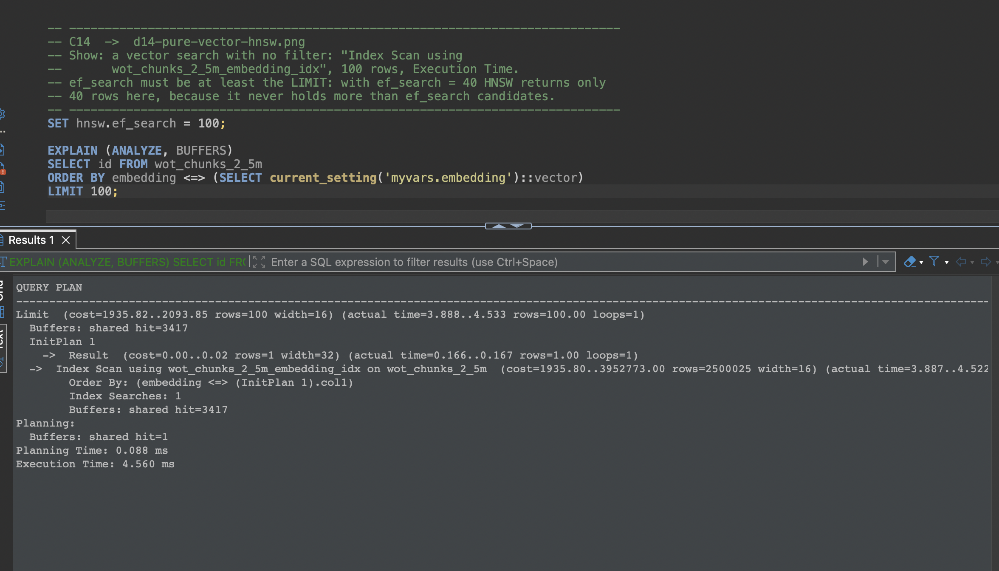
</p>

```sql
-- Diagnostic query: the benchmark's filtered search, wrapped in EXPLAIN ANALYZE
SET hnsw.ef_search = 40;          -- pgvector default
SET hnsw.iterative_scan = off;    -- pgvector default

EXPLAIN (ANALYZE, BUFFERS)
SELECT id
FROM wot_chunks_2_5m
WHERE metadata->>'book_name' = '00. New Spring'
ORDER BY embedding <=> :'query_vector'::vector
LIMIT 40;
```

### The Fast Path: LIMIT 40

```
Limit  (cost=971.87..13637.69 rows=40) (actual time=1.399..1.522 rows=18 loops=1)
  Buffers: shared hit=1456
  ->  Index Scan using wot_chunks_2_5m_embedding_idx on wot_chunks_2_5m
        (cost=971.87..3959042.75 rows=12500) (actual time=1.398..1.520 rows=18 loops=1)
        Order By: (embedding <=> '[query vector]'::vector)
        Filter: ((metadata ->> 'book_name') = '00. New Spring')
        Rows Removed by Filter: 22
        Index Searches: 1
Planning Time: 0.047 ms
Execution Time: 1.534 ms
```

**What is happening here**: PostgreSQL is using the **HNSW vector index** (`wot_chunks_2_5m_embedding_idx`). It traverses the HNSW graph to find the nearest neighbors by vector distance, then applies the `book_name` filter as a post-filter, discarding non-matching rows. It found 18 matching rows among 40 candidates (18 kept + 22 filtered out). Total: **1.5 ms**.

This is the efficient path. The HNSW index does the heavy lifting, traversing a graph structure that can find approximate nearest neighbors in logarithmic time, and the metadata filter just removes non-matching results.

But notice that only **18 rows** came back, although the query asked for 40. This is the index-level completeness problem: with `ef_search = 40`, the index collected 40 candidates, 22 of them belonged to other books, and the scan stopped. Nothing in the result tells the application that rows are missing. The planner made the right decision to use HNSW here; the shallow candidate pool is a separate problem from the plan switch, and the one iterative scan was designed to solve.

<p align="center">
  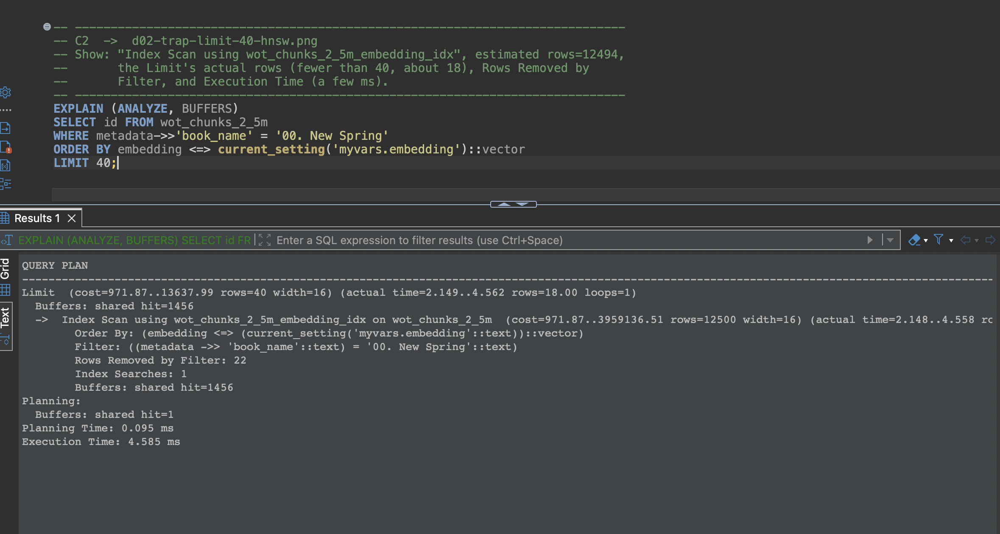
</p>

### The Catastrophic Path: LIMIT 41

```
Limit  (cost=13557.83..13557.94 rows=41) (actual time=358.105..358.111 rows=41 loops=1)
  Buffers: shared hit=305980
  ->  Sort  (cost=13557.83..13589.08 rows=12500) (actual time=358.104..358.106 rows=41 loops=1)
        Sort Key: ((embedding <=> '[query vector]'::vector))
        Sort Method: top-N heapsort  Memory: 27kB
        ->  Bitmap Heap Scan on wot_chunks_2_5m
              (cost=109.41..13160.49 rows=12500) (actual time=11.344..348.928 rows=63945 loops=1)
              Recheck Cond: ((metadata ->> 'book_name') = '00. New Spring')
              Heap Blocks: exact=50143
              ->  Bitmap Index Scan on wot_chunks_2_5m_expr_idx
                    (cost=0.00..106.28 rows=12500) (actual time=4.042..4.043 rows=63945 loops=1)
                    Index Cond: ((metadata ->> 'book_name') = '00. New Spring')
Planning Time: 0.082 ms
Execution Time: 358.129 ms
```

**What is happening here**: One more requested row, and PostgreSQL completely abandoned the HNSW index. Instead, it executed a three-step plan:

<p align="center">
  
</p>

1. **Bitmap Index Scan** on the B-tree `wot_chunks_2_5m_expr_idx`: finds all 63,945 row IDs matching `book_name = '00. New Spring'` in 4 ms
2. **Bitmap Heap Scan**: fetches all 63,945 rows (50,143 heap blocks, 305,980 buffer pages including the out-of-line embeddings)
3. **Sort**: computes `embedding <=> query_vector` distance for **all 63,945 rows** using brute-force calculation, then sorts and picks the top 41

Step 3 is the killer. A single query went from **1.5 ms to 358 ms, a 233x increase**, with everything already in memory. For the largest book, `'06. Lord of Chaos'` (209,226 matching rows), the same plan took **1.1 seconds**. Both figures are with every page already in memory; uncached pages add disk reads on top.

<p align="center">
  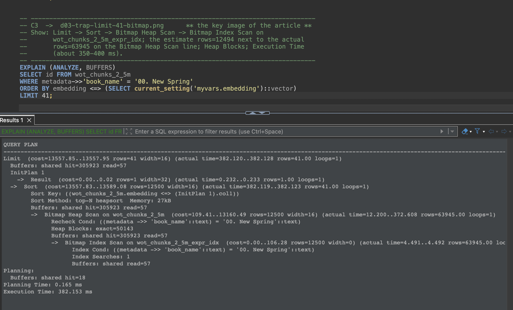
</p>

<p align="center">
  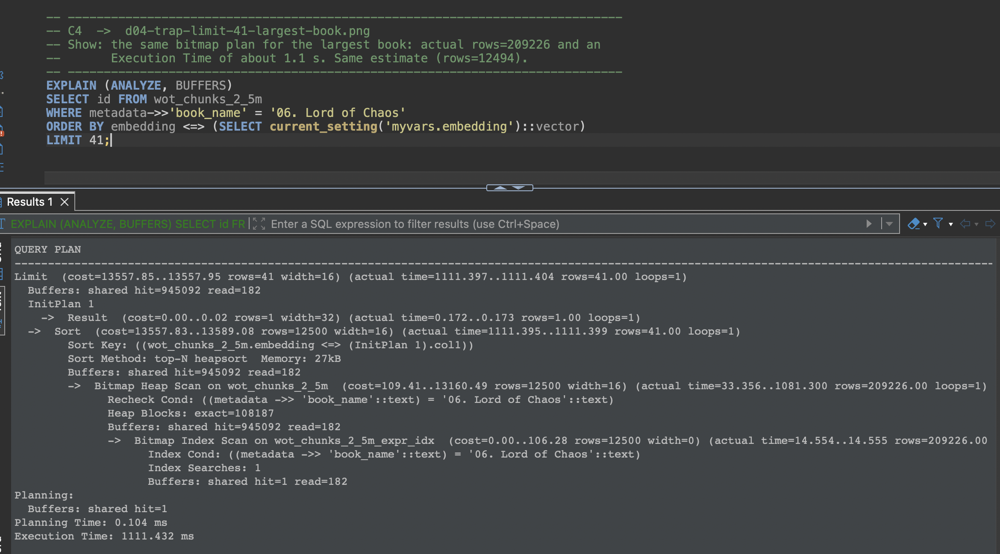
</p>

---

## Why Does the Query Planner Switch?

For our filtered search query, the planner considers two main strategies:

**Strategy A: HNSW Index Scan + Post-Filter**

- Use the HNSW index to traverse the vector graph
- For each candidate, check if `book_name` matches
- Stop when `LIMIT` rows are found
- Cost depends on: how deep into the graph it needs to go before finding enough matching rows

**Strategy B: B-Tree Metadata Scan + Brute-Force Sort**

- Use the B-tree index on `metadata->>'book_name'` to find all matching rows
- Fetch all matching rows from the table (heap)
- Compute vector distance for every row, sort, take top N
- Cost depends on: number of matching rows multiplied by cost per distance computation

Both cost estimates hinge on one number: how many rows match the filter.

### The Clue in the Row Estimate

Look at `rows=` in the two plans above. In every node that reads the filtered rows, both plans say **`rows=12500`**. That is the planner's estimate of how many rows match `book_name = '00. New Spring'`. The `actual ... rows=63945` in the second plan is what really matched: the planner was off by a factor of five.

12,500 is not a coincidence. It is exactly **0.5% of 2.5 million**, PostgreSQL's default guess for an equality condition when it has no statistics (described in [Table Statistics](#table-statistics-how-the-planner-guesses-row-counts)). Checking `pg_stats` confirmed it: there were no rows at all for `wot_chunks_2_5m_expr_idx`.

<p align="center">
  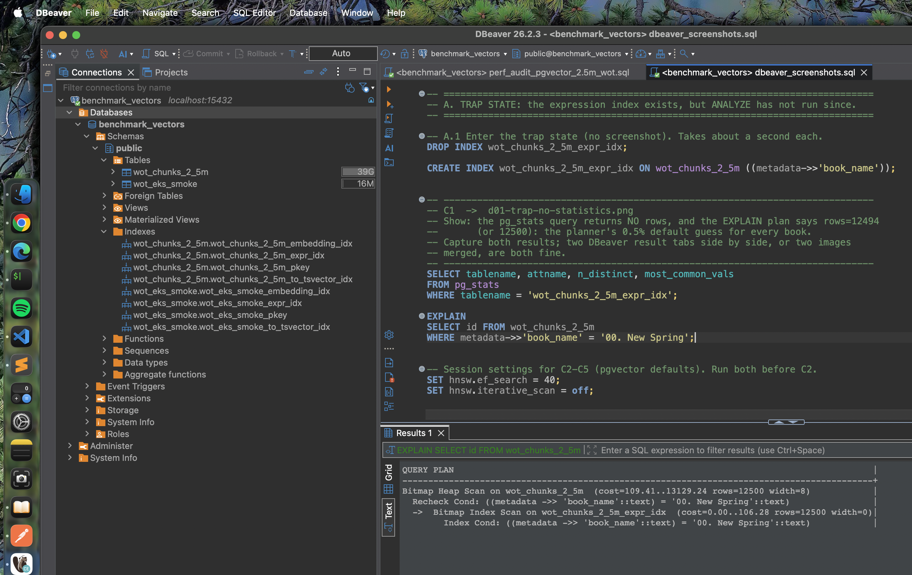
</p>

### How a Wrong Estimate Flips the Plan

The planner's arithmetic is visible in the plans themselves. For a `LIMIT` on top of an index scan, the planner assumes rows arrive at an even rate, so the cost of the first _k_ rows is roughly:

```text
cost(LIMIT k) ≈ startup cost + full scan cost × k / (rows expected to match)
```

With the default estimate of 12,500 matching rows and the HNSW scan's full cost of 3,959,042.75:

```text
LIMIT 40: 971.87 + (3,959,042.75 − 971.87) × 40 / 12,500 = 13,637.7   ← HNSW
LIMIT 41: 971.87 + (3,959,042.75 − 971.87) × 41 / 12,500 = 13,954.4
Bitmap + sort plan for an expected 12,500 rows:            13,557.8   ← chosen at LIMIT 41
```

Each extra requested row adds about 317 units to the HNSW path, because the planner believes only 1 row in 200 will pass the filter and so expects to read 200 graph candidates per result. Between `LIMIT 40` and `LIMIT 41`, the HNSW line crosses the brute-force plan's estimate.

The underestimate pushes both sides the wrong way at once. It makes HNSW look **more** expensive (fewer matches means a longer expected walk through the graph per result) and brute force look **cheaper** (fewer rows to fetch and sort). With a realistic count, the picture reverses. At `LIMIT 50`, in planner cost units:

| Planner's estimate of matching rows | HNSW plan | Bitmap + sort plan | Plan chosen |
| ----------------------------------- | --------- | ------------------ | ----------- |
| 12,500 (no statistics, 0.5% guess)  | 16,804    | 13,576             | Bitmap      |
| 67,978 (after `ANALYZE`, one sample) | 3,883    | 59,545             | HNSW, by 15x |

With the realistic estimate, each extra requested row adds only about 58 units to the HNSW path instead of 317, and the brute-force plan, now expected to process 68,000 rows, starts at 59,545. The two lines would not cross until around `LIMIT 1,000`.

### The Exact Tipping Point — and Why It Looked Filter-Agnostic

To find the exact threshold, I swept the `LIMIT` from 1 upward for all 16 book filters in the dataset using [`cnpg_planner_tipping_point_all_books.py`](scripts/cnpg_planner_tipping_point_all_books.py) — a script that runs `EXPLAIN (ANALYZE, BUFFERS)` at each value, detects whether the planner chose HNSW or Bitmap, and records the execution time for each combination. Without statistics, the result is unambiguous: **every single filter switches at exactly the same `LIMIT`**, regardless of how many rows it matches or what percentage of the table it represents.

<p align="center">
  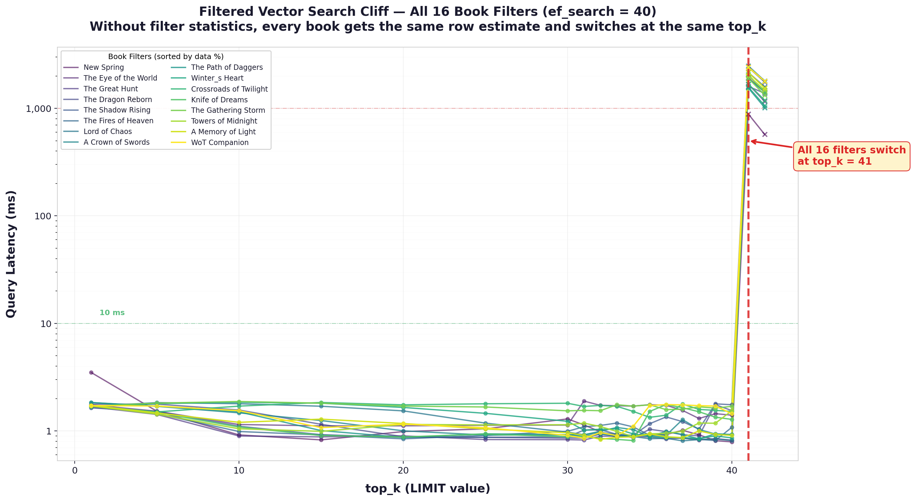
</p>

With the default `hnsw.ef_search = 40`, the planner uses the HNSW index for `LIMIT ≤ 40` and switches to the brute-force Bitmap Heap Scan at `LIMIT = 41` — for every filter from `'00. New Spring'` (2.56% of data, 63,945 rows) to `'06. Lord of Chaos'` (8.37%, 209,226 rows). The cliff is not gradual: latency jumps from a few milliseconds to 0.6 to 2.5 seconds in a single `LIMIT` increment.

It is tempting to conclude from this that the planner ignores filter selectivity. That was my first reading. It is not what happens: the planner never _had_ the selectivity. Every book received the same default estimate of 12,500 rows, so the arithmetic above came out identical for every book, and so did the tipping point. **A tipping point that is the same for every filter value is the signature of a default estimate**, and a useful thing to look for in your own sweeps.

### Does Raising `ef_search` Help?

The natural instinct is to increase `hnsw.ef_search` — a larger search queue means the HNSW index explores more candidates, which should help it find enough filtered matches. So does raising `ef_search` also push the tipping point higher, giving us more usable `top_k` range?

Without statistics, the answer is the opposite. I ran the same sweep at `ef_search = 40, 100, 200, 400`:

<p align="center">
  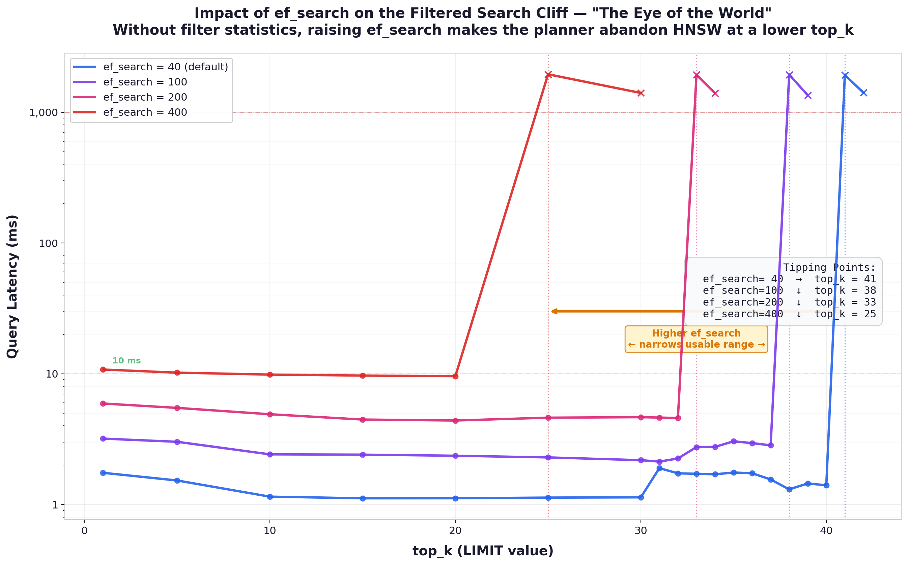
</p>

| ef_search        | HNSW Latency (avg) | Tipping Point | HNSW works up to |
| ---------------- | ------------------ | ------------- | ---------------- |
| **40** (default) | ~1.2 ms         | LIMIT 41      | LIMIT ≤ 40       |
| 64 (benchmark)   | not swept          | LIMIT 39      | LIMIT ≤ 38       |
| 100              | ~2.5 ms        | LIMIT 38      | LIMIT ≤ 37       |
| 200              | ~5.3 ms        | LIMIT 33      | LIMIT ≤ 32       |
| 400              | ~10.7 ms        | LIMIT 25      | LIMIT ≤ 24       |

Raising `ef_search` is a **double loss** in this state: it increases HNSW query latency (the search queue does more work) _and_ it shrinks the usable `LIMIT` range. With `ef_search = 400`, the planner abandons HNSW at just `LIMIT 25`.

The mechanism follows from the same arithmetic: pgvector's cost estimate for an HNSW scan grows with `ef_search` (its startup cost rises from 972 at `ef_search = 40` to about 1,936 at 100), so the HNSW line starts higher and crosses the brute-force estimate at a lower `LIMIT`. Again, this was identical across all filters at each `ef_search` setting, for the same reason. The benchmark itself uses `ef_search = max(64, top_k)`, which is why its cliff appeared between `top_k = 20` and `top_k = 50`.

### Confirming the Cause: Run `ANALYZE`

If the default estimate is the cause, giving the planner real statistics should remove the cliff. One command:

```sql
ANALYZE wot_chunks_2_5m;
```

Afterwards, `pg_stats` has a row for the expression index with 16 distinct values and the frequency of each book, and the same `LIMIT 41` query plans very differently:

```
Limit  (cost=971.79..3582.13 rows=41) (actual time=0.829..0.913 rows=18 loops=1)
  Buffers: shared hit=1456
  ->  Index Scan using wot_chunks_2_5m_embedding_idx on wot_chunks_2_5m
        (cost=971.79..3959263.99 rows=62172) (actual time=0.828..0.911 rows=18 loops=1)
        Order By: (embedding <=> '[query vector]'::vector)
        Filter: ((metadata ->> 'book_name') = '00. New Spring')
        Rows Removed by Filter: 22
        Index Searches: 1
Planning Time: 0.038 ms
Execution Time: 0.923 ms
```

The estimate is now 62,172 rows, close to the real 63,945, and the planner keeps HNSW: **0.9 ms instead of 358 ms**. (`ANALYZE` reads a random sample, so the estimate moves a little each time it runs; across the runs in this investigation it was between about 60,000 and 68,000.) Rerunning the tipping-point check in this state, **the planner chose HNSW for every `LIMIT` from 1 to 200, at every `ef_search` from 40 to 400, for each of the three test books** — the smallest (`'00. New Spring'`), a mid-sized one (`'13. Towers of Midnight'`) and the largest (`'06. Lord of Chaos'`). Removing the statistics again brings the cliff back at exactly `LIMIT 41`. Nothing else changed between the two states: same data, same indexes, same settings, same query vector.

Notice that the plan above still returned only 18 rows. Fixing the plan does not fix completeness: with iterative scan off, HNSW still stops after 40 candidates. For the largest book, the same query returned **no rows at all** — all 40 nearest candidates came from other books. That is the second trap, and the reason the benchmark enables iterative scan for filtered queries.

<p align="center">
  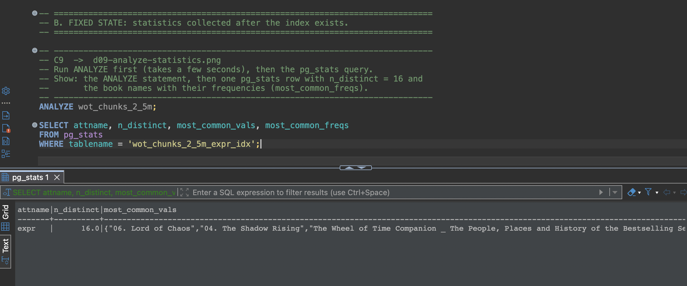
</p>

<p align="center">
  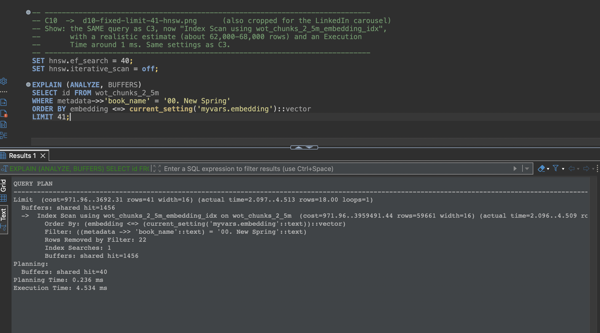
</p>

The cost-model weakness described earlier has not disappeared: the planner still prices a 1,536-dimension distance like a cheap operator, so with accurate statistics the brute-force plan would still win at a high enough `LIMIT`. With these statistics that point is around `LIMIT` 1,000, far beyond any realistic request. The row estimate decides whether the price weakness matters in practice.

### Additional EXPLAIN ANALYZE Evidence: Compound Filters

Statistics have one more limitation worth knowing about. Consider a compound filter — `book_name = '00. New Spring' AND chapter_number = '5'` — targeting a single chapter within a book (`LIMIT 10`, `ef_search = 40`). Statistics are collected per column (or per indexed expression), and by default the planner assumes that two conditions are independent, multiplying their selectivities. Here they are not independent: a chapter number only means something within its book. The product underestimates the real count, even after `ANALYZE`.

| State | Planner's estimate | Actual rows | Plan | Rows returned | Execution time |
| ----- | ------------------ | ----------- | ---- | ------------- | -------------- |
| No statistics | 62 | 4,129 | Bitmap on book + filter on chapter | 10 | 93 ms |
| `ANALYZE` (per-expression statistics) | 311–329 | 4,129 | Bitmap on book + filter on chapter | 10 | 95–101 ms |
| `ANALYZE` + `CREATE STATISTICS` on both expressions | 1,297–5,165 | 4,129 | HNSW | **2** | 3.2 ms |
| Same + `hnsw.iterative_scan = relaxed_order` | 1,297 | 4,129 | HNSW | 10 | 17 ms |

(Ranges are across two `ANALYZE` samples.)

<p align="center">
  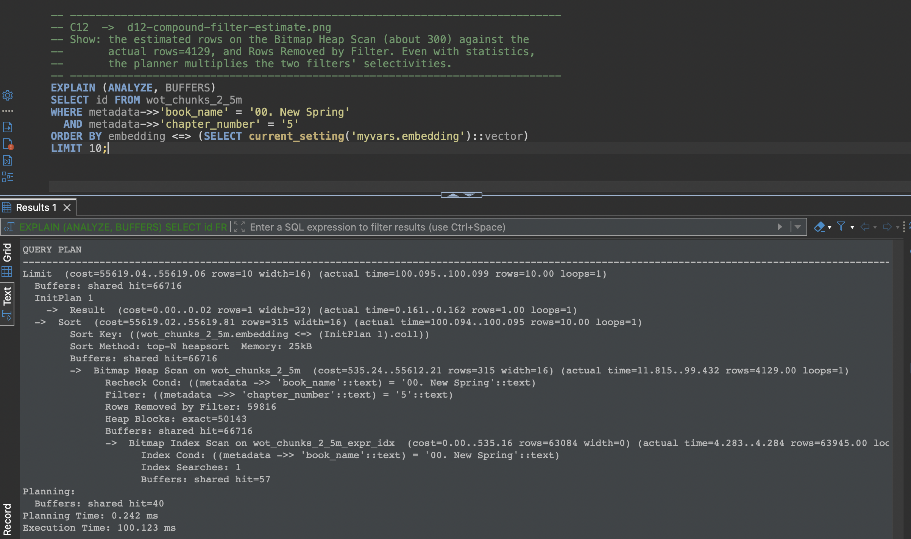
</p>

Three lessons in one table. First, the brute-force plan is not inherently catastrophic: it is a function of **how many rows it must fetch and compute distances for**. For this compound filter it reads the book's 63,945 rows but computes only 4,129 distances, and finishes in about 100 ms — a reasonable plan. The danger zone is the planner _believing_ a filter is that selective when tens of thousands of rows actually match. Second, PostgreSQL's extended statistics (`CREATE STATISTICS`, which supports expressions since PostgreSQL 14) record how two fields vary together and bring the estimate close to reality; [`scripts/diagnose_compound_filter_statistics.sql`](scripts/diagnose_compound_filter_statistics.sql) runs this comparison. Third, the two traps interlock: as soon as the estimate was good enough to choose HNSW, completeness became the problem, because a filter matching 0.17% of the table leaves almost nothing among 40 candidates. Only accurate statistics _and_ iterative scan together gave a fast, complete answer: 10 rows in 17 ms.

For your data, the tipping point will depend on:

- The planner's row estimate for each filter, which depends on whether statistics exist and are current — the most important input
- `hnsw.ef_search` setting (higher ef_search = higher HNSW cost estimate = lower tipping point)
- Vector dimensionality (higher dimensions = more expensive brute-force, which the planner does not account for)
- `random_page_cost` and other planner cost parameters
- Total number of rows and table page count

---

## The Fix: Collect Statistics After Building Indexes

I then ran the complete benchmark matrix again with statistics in place: same data, indexes, settings, client and query set, after `ANALYZE wot_chunks_2_5m`.

<p align="center">
  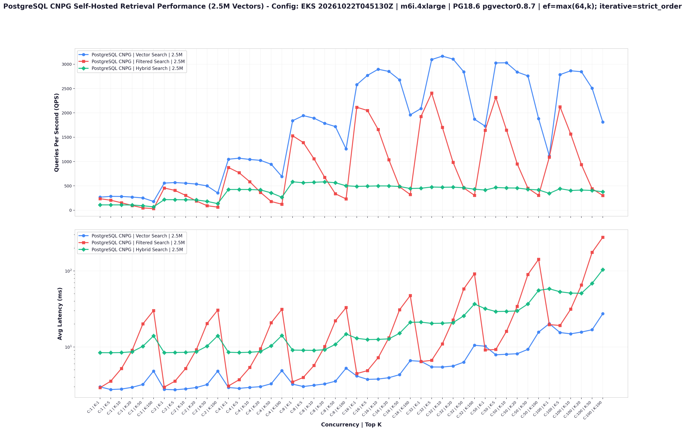
</p>

The filtered search line no longer collapses. Latency rises steadily with `top_k`, as it should — larger requests need more of the graph — but there is no cliff, and **all 629,712 queries completed**, each returning exactly the number of rows it asked for. Filtered search side by side, before and after:

<p align="center">
  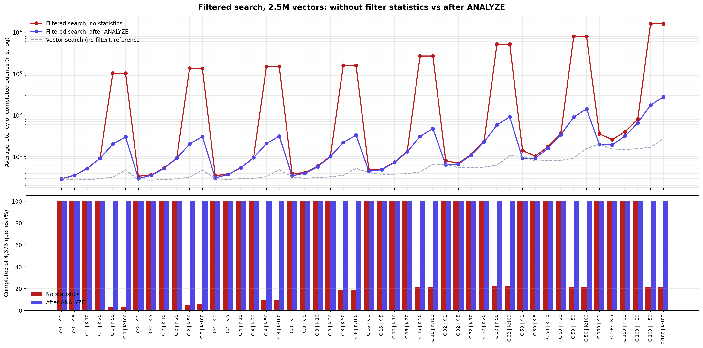
</p>

| Filtered search | Without statistics: avg latency | Completed (of 4,373) | QPS | After `ANALYZE`: avg latency | Completed (of 4,373) | QPS |
| --------------- | ------------------------------- | -------------------- | --- | ---------------------------- | -------------------- | --- |
| `C:1 \| K:20`   | 9.08 ms     | 4,373 | 95.8 | 9.07 ms   | 4,373 | 96.0  |
| `C:1 \| K:50`   | 1,035 ms    | 154   | 0.96 | 20.10 ms  | 4,373 | 46.5  |
| `C:1 \| K:100`  | 1,031 ms    | 154   | 0.96 | 30.08 ms  | 4,373 | 31.7  |
| `C:50 \| K:20`  | 37.25 ms    | 4,373 | 944  | 34.23 ms  | 4,373 | 951   |
| `C:50 \| K:50`  | 7,999 ms    | 954   | 5.95 | 89.93 ms  | 4,373 | 451   |
| `C:50 \| K:100` | 7,961 ms    | 954   | 5.95 | 142.08 ms | 4,373 | 304   |
| `C:100 \| K:50` | 16,090 ms   | 944   | 5.89 | 175.48 ms | 4,373 | 441   |
| `C:100 \| K:100`| 16,005 ms   | 949   | 5.92 | 277.02 ms | 4,373 | 301   |

<p align="center">
  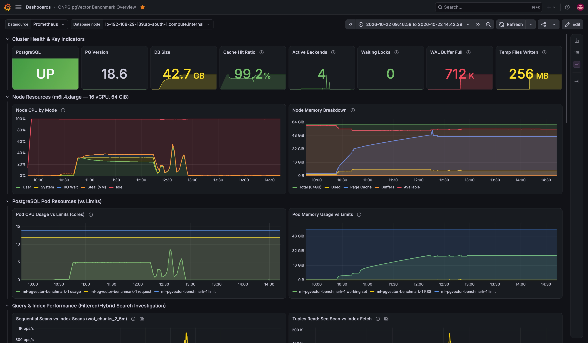
</p>

Below the tipping point (`K:20`) the two states are identical, because the planner picks HNSW in both. Above it, the same hardware and the same queries went from about 6 QPS with most queries timing out to 300–450 QPS with every query completing: **a 33 to 76x throughput difference from one maintenance command**. The latencies without statistics describe only the queries that finished; the rest ran out of their 160-second budget.

Filtered search is still slower than pure vector search: at `C:50 | K:50` it averages 90 ms against 9.31 ms. That is the honest cost of post-filtering with iterative scan — the index keeps exploring until 50 rows from the right book have been found — and it is a few multiples, not a cliff.

**What to do in production:**

1. **Run `ANALYZE` after creating indexes**, especially expression indexes on JSONB fields. Make it the last step of every bulk load or reindex, before traffic arrives. This is the single most effective change in this article.
2. **Run `ANALYZE` after large data changes**, rather than waiting for autovacuum. Autovacuum only re-analyzes after about 10% of a table changes, so a new tenant, product line or document collection can stay invisible to the planner for a long time. New filter values that are missing from the statistics get estimated from the remaining distribution.
3. **Check that statistics exist** for every filtered expression: `SELECT * FROM pg_stats WHERE tablename = '<expression index name>'`. An empty result means the planner is guessing.
4. **Compare `rows=` with `actual rows=`** in `EXPLAIN ANALYZE` for your most common filters. An estimate that is off by 5x or more, or the same estimate for every filter value, deserves attention.
5. **Raise the statistics target for high-cardinality filters.** By default, statistics keep the 100 most common values. For filters with thousands of distinct values (tenants, users), raise it for that expression (`ALTER INDEX ... ALTER COLUMN 1 SET STATISTICS 1000`) or globally with `default_statistics_target`.
6. **Use extended statistics for correlated filters** that are queried together: `CREATE STATISTICS ... ON (expr1), (expr2) FROM table`.

---

## Why the Usual Workarounds Don't Help

Before I found the cause, I tried what is commonly suggested when pgvector ignores an HNSW index: disabling the bitmap scan, disabling other scan types, raising `hnsw.ef_search`, and turning on iterative scan. I reran all of them on the EKS cluster in the state without statistics, at `LIMIT 50` for `'00. New Spring'` with the same query vector, alongside a query rewrite and the actual fix:

| Approach                                   | Uses HNSW? | Rows returned | Latency       | Verdict                                       |
| ------------------------------------------ | ---------- | ------------- | ------------- | --------------------------------------------- |
| Default, no statistics                     | No         | 50            | 358 ms        | The trap                                      |
| `enable_bitmapscan = off`                  | No         | 50            | 339 ms        | Band-aid: B-tree scan + sort instead          |
| Disable all scan types                     | No         | 50            | 361 ms        | Does not work: also disables HNSW             |
| `hnsw.ef_search = 200`                     | No         | 50            | 359 ms        | Counterproductive: cliff moves to LIMIT 33    |
| `hnsw.iterative_scan = relaxed_order`      | No         | 50            | 359 ms        | Does not work: planner never picks HNSW       |
| Iterative scan + disable all scans         | No         | 50            | 357 ms        | Does not work                                 |
| CTE over-fetch, iterative scan off         | Yes        | **18**        | 1.7 ms        | Fast but incomplete                           |
| CTE over-fetch + `relaxed_order`           | Yes        | 50            | 6.7 ms        | Works when the filter's selectivity is known  |
| **`ANALYZE`** (ef 64, `strict_order`)      | **Yes**    | **50**        | **4.6 ms**    | **The fix**                                   |

The pattern is the lesson. Every setting that changes _how_ the HNSW index scans — `ef_search`, iterative scan — does nothing for the plan, because the planner rejects HNSW before any scan starts, using an estimate those settings do not touch. Raising `ef_search` even makes things worse, since it raises pgvector's cost estimate for the HNSW path. The `enable_*` switches only penalise plans; `enable_indexscan = off` penalises the HNSW scan too, because it is an index scan. Only fixing the estimate fixes the plan, and once the plan is right, the original query needs no rewriting.

Two of these remain useful after the fix, as defensive patterns rather than cures:

- **The CTE over-fetch** wraps an unfiltered vector search in a CTE and applies the filter outside it, so the planner has no alternative to HNSW. It protects queries whose estimates statistics cannot get right, such as correlated filters or a filter value that grows faster than autovacuum re-analyzes. It needs iterative scan: without it, the inner scan stops after `ef_search` candidates and the query quietly returns fewer rows (18 of 50 here).
- **`enable_bitmapscan = off`** is an emergency switch while you investigate. It avoids the bitmap plan but not brute force, and it changes plans for every query on the connection.

The SQL, reasoning and plan screenshots for each approach are in [doc/workarounds.md](doc/workarounds.md).

---

## The Second Problem: Why Hybrid Search is About 3x Slower

With the filtered search cliff understood, I turned to the second anomaly in the benchmark data: hybrid search (vector + full-text via RRF) is consistently about 3x slower than pure vector search, in both database states and even at low `top_k` values. At `C:1 | K:10` after `ANALYZE`, hybrid search averaged **8.45 ms** against **2.80 ms** for vector search; at `C:100 | K:100` it delivered **378 QPS** against **1,811 QPS**.

To identify the bottleneck, I ran `EXPLAIN ANALYZE` on each component of the hybrid query in isolation, then on the full combined query, using [`scripts/diagnose_hybrid_components.sql`](scripts/diagnose_hybrid_components.sql).

### Decomposing the Hybrid Query

The hybrid search query has four logical parts:

1. **Vector CTE**: Pure HNSW vector search to find nearest neighbors
2. **Text CTE**: GIN-based full-text search with `ts_rank()` scoring
3. **FULL OUTER JOIN**: Merge vector and text results by row ID
4. **RRF scoring + final sort**: Compute Reciprocal Rank Fusion scores and return top N

I measured each part independently (server-side `EXPLAIN ANALYZE`, single connection, warm cache, keyword `'dragon'`):

| Component                                 | Latency          | What It Does                                                    |
| ----------------------------------------- | ---------------- | --------------------------------------------------------------- |
| **Pure vector search** (LIMIT 10)         | **1.6 ms**    | HNSW index scan, returns 10 rows                                |
| **Vector CTE with ROW_NUMBER** (LIMIT 20) | **1.0 ms**   | Same HNSW scan + window function (negligible overhead)          |
| **Text search CTE alone** (LIMIT 20)      | **596 ms**     | GIN bitmap scan on 76,198 matching rows + ts_rank on all + sort |
| **Full hybrid RRF** (top_k=10)            | **592 ms**   | Both CTEs + FULL OUTER JOIN + RRF sort                          |
| **Full hybrid RRF** (top_k=50)            | **594 ms**   | Same, larger CTE limits                                         |

The answer is immediately clear: **the text search CTE alone takes 596 ms, essentially the whole hybrid query**. The vector CTE takes about 1 ms, and the FULL OUTER JOIN and RRF computation add nothing measurable on top.

I chose `'dragon'` deliberately: it is a common term in this corpus, matching 76,198 of the 2.5 million rows, so it shows the mechanism clearly. Most keywords in the query set match far fewer rows, which is why the benchmark's hybrid average is 8.45 ms at `C:1 | K:10` rather than hundreds of milliseconds. The cost of hybrid search grows with the number of rows the keyword matches, and a product that lets users search for common terms will see the slow end of that range.

### What the Text Search Plan Reveals

The `EXPLAIN ANALYZE` output for the text search CTE tells the full story:

```
Limit  (actual time=583.506..595.833 rows=20 loops=1)
  ->  WindowAgg  (actual time=583.504..595.829 rows=20 loops=1)
        ->  Gather Merge  (actual time=583.497..595.817 rows=20 loops=1)
              Workers Planned: 4
              Workers Launched: 4
              ->  Sort  (actual time=580.646..580.713 rows=580 loops=5)
                    Sort Key: (ts_rank(to_tsvector('english', content), '''dragon'''::tsquery)) DESC
                    Sort Method: quicksort  Memory: 863kB
                    ->  Parallel Bitmap Heap Scan on wot_chunks_2_5m
                          (actual time=21.352..578.138 rows=15240 loops=5)
                          Recheck Cond: (to_tsvector('english', content) @@ '''dragon'''::tsquery)
                          Heap Blocks: exact=11904
                          ->  Bitmap Index Scan on wot_chunks_2_5m_to_tsvector_idx
                                (actual time=14.168..14.168 rows=76198 loops=1)
Execution Time: 595.917 ms
```

Here is what happens step by step:

<p align="center">
  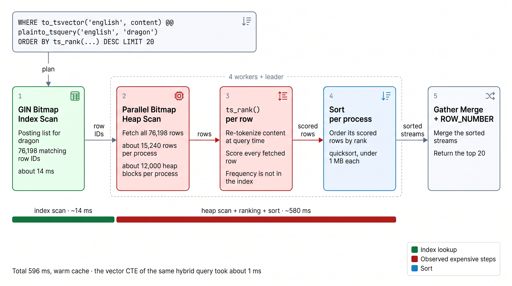
</p>

The bottleneck is steps 2 and 3. PostgreSQL must:

- **Fetch every one of the 76,198 matching rows** from the heap (the actual table pages)
- **Compute `ts_rank()` on each row**, which involves re-tokenizing the `content` text column at query time
- **Sort all of the scored rows** just to return the top 20

This is the same "fetch all, score all, sort all" pattern we saw in the filtered search cliff. The GIN index efficiently identifies which rows contain the keyword, but it cannot rank them. PostgreSQL has no way to say "give me the top 20 rows by `ts_rank` directly from the index" because `ts_rank()` depends on term frequency within each document, which is not stored in the GIN index.

<p align="center">
  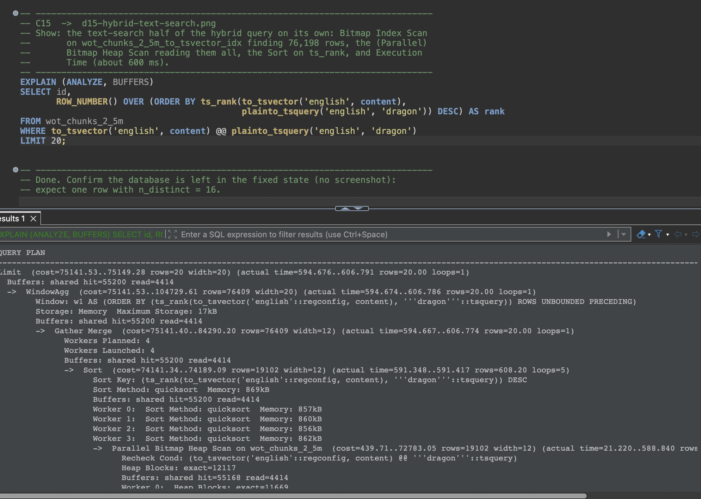
</p>

### Why This Is Not a Query Structure or Client-Side Issue

The diagnosis rules out several hypotheses:

- **Not the RRF algorithm**: The FULL OUTER JOIN and RRF computation add little on top of the two CTEs
- **Not the ROW_NUMBER window function**: Adding ROW_NUMBER to the vector CTE adds almost nothing
- **Not the CTE materialization overhead**: PostgreSQL plans the CTEs efficiently
- **Not the vector CTE**: The HNSW search completes in a few milliseconds within the full hybrid plan
- **Not a client-side bottleneck**: All timing is measured server-side via `EXPLAIN ANALYZE`

It is entirely a **server-side architectural limitation**: PostgreSQL's GIN index cannot produce ranked results without fetching and scoring every matching row.

### Why This Does Not Degrade with top_k

Unlike the filtered search cliff, hybrid search latency remains relatively stable across `top_k` values (592 ms at top_k=10 vs 594 ms at top_k=50). This makes sense: the expensive part is fetching and scoring all the text matches, and changing the final `LIMIT` does not change how many rows the text CTE must process.

### Potential Mitigations

1. **Pre-computed `tsvector` column**: Store the tokenized vector as a materialized column (`ALTER TABLE ADD COLUMN tsv tsvector GENERATED ALWAYS AS (to_tsvector('english', content)) STORED`) to avoid re-tokenizing at query time. This saves CPU but still requires fetching all matching rows.

2. **Reduce the text CTE over-fetch**: The current implementation uses `LIMIT top_k * 2` in the text CTE, but this does not help because PostgreSQL must still compute `ts_rank()` on all matching rows before it can pick the top N.

3. **RUM index extension**: The `rum` extension (if available) extends GIN to support ordering within the index itself, potentially allowing "top N by rank" queries without fetching all matches. This is the most promising server-side mitigation but requires installing an additional extension.

4. **Accept the trade-off**: At 8 to 15 ms per query in the concurrent benchmark at low concurrency (vs about 3 ms for vector search), hybrid search may still be acceptable for many use cases. The absolute latency is reasonable; it is the relative gap that is notable, and it grows with how many rows the keywords match.

---

## Comparison: How Purpose-Built Vector Databases Differ

Both problems in this article come from PostgreSQL's architecture: a general-purpose query planner that chooses between alternative strategies from estimates, and a separation between index lookup and result scoring. Purpose-built vector databases such as **Milvus** handle these operations differently:

- **Filtered search**: Milvus applies the filter and the vector search as a single integrated operation within the index layer. There is no query planner choosing between alternative strategies, so there is no row estimate that can be wrong and no tipping point where performance collapses.
- **Hybrid search**: Purpose-built engines implement text ranking natively within their index structures, avoiding the "fetch all, score all, sort all" pattern that PostgreSQL's GIN index requires.

This is not a criticism of PostgreSQL. It is a general-purpose relational database doing something it was not originally designed for, and with current statistics and iterative scan, pgvector's filtered search performed well in this benchmark. The difference is operational: in PostgreSQL, filtered vector search is only as good as the planner's estimates, so keeping statistics current becomes part of running the system, in the same way as backups or vacuuming.

---

## Recommendations

### If You Are Using pgvector in Production

1. **Run `ANALYZE` after every index build and bulk load.** Make it the last step of your loading pipeline, before the table serves traffic. Without it, an expression index on a JSONB field gives the planner no information at all.

2. **Check for the trap in five seconds.** Query `pg_stats` for each filtered expression index, and run `EXPLAIN` on a filtered query: if `rows=` equals 0.5% of your table for every filter value, the planner is guessing.

3. **Enable iterative scan for filtered queries.** `SET hnsw.iterative_scan = relaxed_order` (or `strict_order` if exact distance ordering matters) lets the index keep scanning until enough filtered rows are found. Without it, filtered queries can quietly return fewer rows than requested. Tune `hnsw.max_scan_tuples` for very selective filters.

4. **Test your actual query patterns** with `EXPLAIN ANALYZE` at your production `top_k` values, and compare estimated rows with actual rows. Do not assume small-scale benchmarks will extrapolate.

5. **Do not raise `hnsw.ef_search` to fix a plan switch.** It raises the cost estimate for HNSW and, without statistics, makes the cliff happen at a _lower_ `top_k`. Raise it for recall, after the plan is right.

6. **Use extended statistics for correlated filters** that are queried together, and raise the statistics target for high-cardinality filters.

7. **Keep the CTE over-fetch pattern as a guard** for queries whose plans you cannot control, and enable iterative scan inside it.

8. **Profile your hybrid search queries.** Run `EXPLAIN ANALYZE` on the text CTE in isolation to understand how many rows your keywords match. If common search terms match tens of thousands of rows, expect the text component to dominate query time. Consider a pre-computed `tsvector` column or the `rum` extension.

9. **Monitor Prometheus metrics** for sudden CPU spikes and heap block reads during filtered search. This is the telltale sign of the planner choosing brute force.

### If You Are Evaluating Vector Databases

pgvector can serve filtered vector search well at this scale, but only with operational discipline: current statistics, iterative scan, and query-plan monitoring. If your team is comfortable operating PostgreSQL, that is a reasonable trade for keeping vectors next to application data. If your application relies heavily on combined vector and full-text search, or on filters whose distribution changes constantly, weigh the hybrid search cost and the statistics maintenance against a purpose-built vector database that handles both natively.

---

## Conclusion

pgvector is a remarkable extension that brings vector search to PostgreSQL. At 2.5 million vectors, on a production-style CloudNativePG deployment, it performed well for pure vector search and, with the right maintenance, for filtered search too. Getting there meant understanding three traps:

1. **Filtered search depends on the planner's estimates.** Without statistics for the filter expression, PostgreSQL assumed every book matched 0.5% of the table, and at `LIMIT 41` it replaced a 1.5 ms HNSW scan with a 358 ms brute-force scan, while under concurrent load most queries timed out. The ordinary sequence of loading data and then creating indexes leaves a table in exactly this state, and nothing fixes it automatically. One `ANALYZE` after the indexes are built removed the cliff entirely. The investigation also showed why the symptoms misled me at first: a tipping point identical for every filter looks like a planner that ignores selectivity, when it is really a planner that was never given it.

2. **The HNSW index does not know about filters.** Even with the right plan, a filtered query can quietly return fewer rows than requested — 18 out of 40 in this test. pgvector 0.8.0's iterative scan fixes that, but only after the planner has chosen the HNSW path, which is why it could not help with the first trap.

3. **Hybrid search pays for ranking.** PostgreSQL's GIN index cannot produce relevance-ranked results without fetching and scoring every matching row. For common keywords that match tens of thousands of documents, this "fetch all, score all, sort all" pattern makes the full-text component dominate hybrid query time, regardless of how fast the vector component is.

None of these is a bug in pgvector or PostgreSQL. They are consequences of running vector and hybrid search inside a general-purpose relational database whose planner works from estimates and whose indexes were designed for exact matching. The practical lesson is that PostgreSQL as a vector database is not only an indexing decision but an operational one: load, index, **analyze**, enable iterative scan, and keep checking that the planner's estimates match reality.

---

_All benchmark code, Kubernetes configurations, and diagnostic scripts referenced in this article are available in this repository._

_Environment: Amazon EKS 1.36 (ap-south-1), CloudNativePG 1.30.1, PostgreSQL 18.6, pgvector 0.8.7, m6i.4xlarge vector node (16 vCPU, 64 GiB), 200 GiB EBS gp3 (6,000 IOPS). Benchmark runs on 22 October 2026: `20261022T045130Z` (full study, with statistics) and `pgvector-trap-no-stats-20261022`, 11:15 to 12:22 UTC (retrieval matrix without statistics). Evidence in [doc/RUN_EVIDENCE.md](doc/RUN_EVIDENCE.md) and [doc/results/](doc/results/)._

---

## Repository Structure

```
pgvector-filtering-investigation/
├── README.md                          # This article
├── pyproject.toml                     # Python dependencies
│
├── src/
│   ├── pgvector/                      # Benchmark scripts
│   │   ├── common.py                  # Shared config (table names, connection params, HNSW settings)
│   │   ├── 01_insert_benchmark_copy.py # PostgreSQL COPY binary insert (10-50x faster)
│   │   ├── 02_create_indexes.py       # HNSW + B-tree + GIN index creation
│   │   └── 03_retrieval_asyncpg.py    # Async retrieval (vector, filtered, hybrid)
│   └── shared/                        # Shared utilities
│       ├── dataset.py                 # Parquet dataset loader
│       ├── results_db.py              # Results DB writer
│       ├── schema_registry.py         # Dataset column mapping (data/*.yaml)
│       ├── common_utils.py            # Shared constants and helpers
│       └── logger_structlog.py        # structlog configuration
│
├── scripts/
│   ├── aws/                           # EKS deployment, S3 transfer, full-study orchestration
│   ├── diagnose_statistics_trap.sql   # Both database states: estimates, tipping points, workarounds
│   ├── diagnose_hybrid_components.sql # Hybrid query decomposition
│   ├── diagnose_compound_filter_statistics.sql # Compound filters and extended statistics
│   ├── cnpg_planner_tipping_point_all_books.py  # LIMIT sweep for all 16 books
│   ├── plot_article_benchmarks.py     # Benchmark result charts
│   ├── plot_statistics_comparison.py  # Filtered search before/after ANALYZE
│   ├── plot_tipping_point_article.py  # Tipping-point charts
│   ├── perf_audit_pgvector_2.5m_wot.sql # Standalone SQL for all search patterns
│   └── sync_article.py                # Keeps doc/article.md in sync with this README
│
├── data/
│   └── wot_dataset.yaml               # Dataset column config
│
├── infrastructure/
│   ├── aws/                           # EKS cluster, storage, dataset PVC, results DB, Jobs
│   ├── docker/
│   │   └── Dockerfile                 # Benchmark engine Docker image
│   └── cnpg-pgvector/
│       ├── Dockerfile                 # Custom PostgreSQL 18.6 + pgvector 0.8.7
│       ├── cluster.yaml               # CNPG Cluster CRD definition
│       └── monitoring/                # Prometheus/Grafana configs and dashboard
│
└── doc/
    ├── CNPG_PGVECTOR_SETUP.md         # EKS and CNPG cluster setup guide
    ├── CNPG_MONITORING_SETUP.md       # Prometheus/Grafana monitoring setup
    ├── execution-guide.md             # Staging, Jobs, both database states, DBeaver, sweeps
    ├── DATASET.md                     # Dataset schemas and bring-your-own data
    ├── RUN_EVIDENCE.md                # What ran, when, with which images and settings
    ├── workarounds.md                 # Every filtered-search workaround tested, in full
    ├── results/                       # Exported results and diagnostic outputs
    ├── diagrams/                      # Article diagrams and their generation prompts
    ├── plots/                         # Benchmark result charts
    └── screenshots/                   # AWS console, Grafana and DBeaver captures
```

For step-by-step instructions to reproduce everything from scratch, see [`doc/execution-guide.md`](doc/execution-guide.md).
