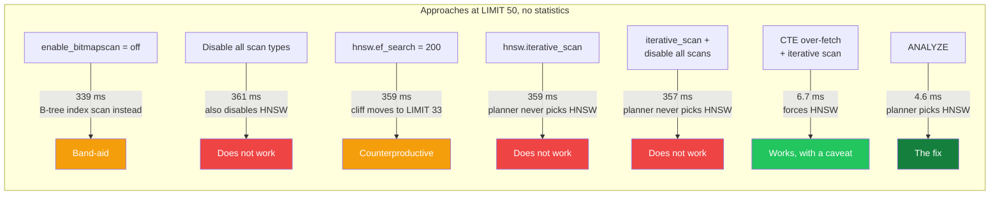
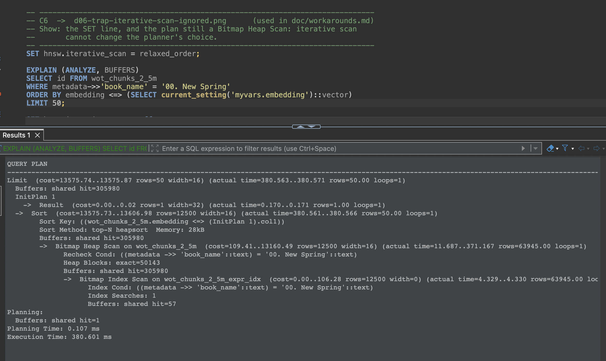
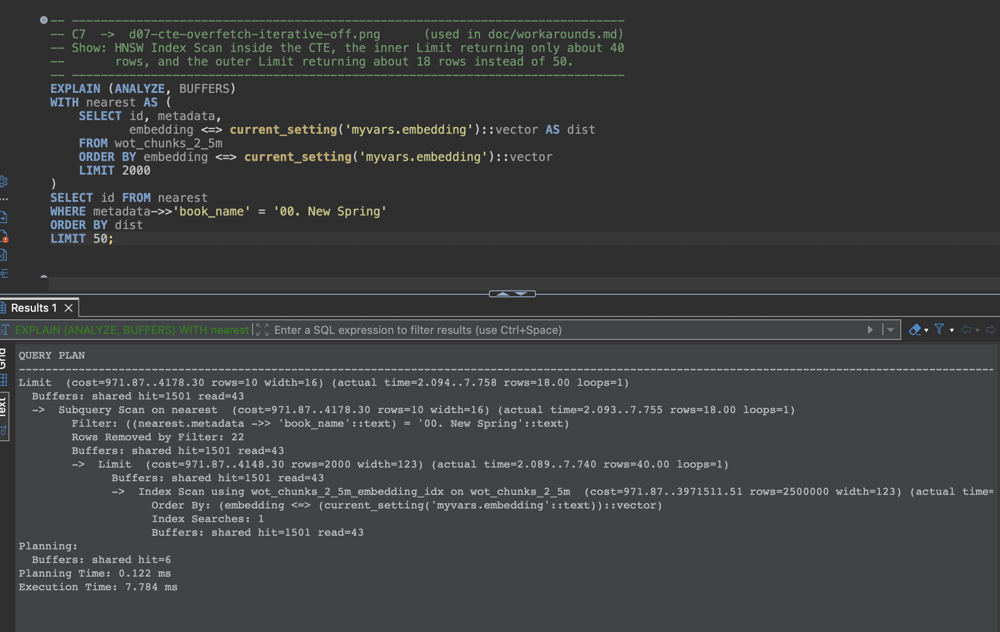
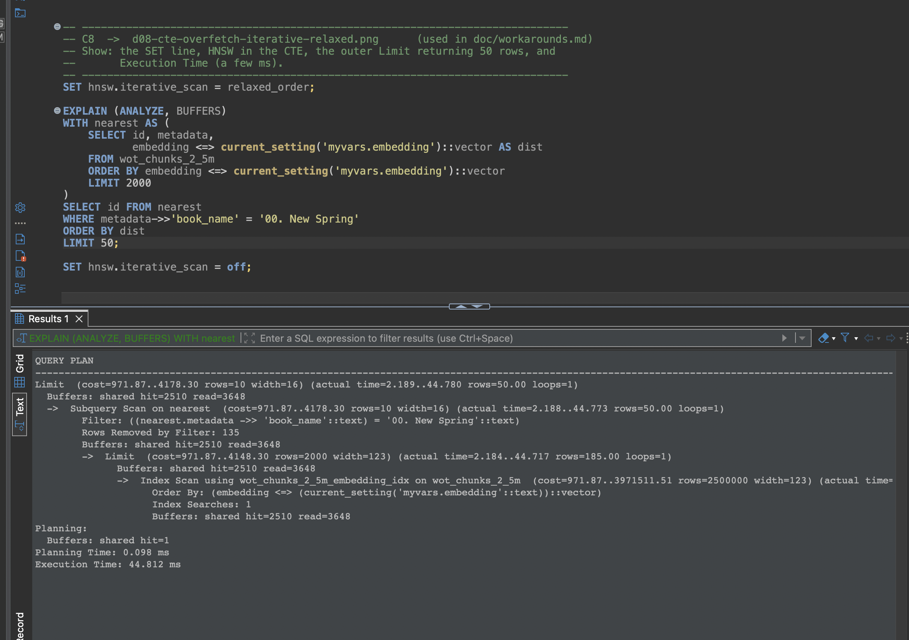

# Filtered Search Workarounds: Full Results

This is the detailed companion to the [article](../README.md#why-the-usual-workarounds-dont-help). It records every approach I tested against the filtered-search cliff, with the SQL, the reasoning and the measured result.

**Context.** The cliff comes from missing statistics for the `metadata->>'book_name'` expression index: without them, the planner assumes every book matches 0.5% of the table (12,500 rows) and switches from the HNSW index to a brute-force bitmap scan at `LIMIT 41`. The fix is `ANALYZE` after creating the index (Approach 7). Approaches 1 to 6 are what is commonly suggested for "pgvector ignores my HNSW index"; they were all measured in the state **without statistics**, which is where they would be tried. The full diagnostic output is in [results/eks-20261022-trap-no-stats.txt](results/eks-20261022-trap-no-stats.txt) and [results/eks-20261022-fixed-stats.txt](results/eks-20261022-fixed-stats.txt), produced by [diagnose_statistics_trap.sql](../scripts/diagnose_statistics_trap.sql).

## What I Tested

Before I found the cause, I tested six workarounds against the planner's bad decision. I reran all of them in the no-statistics state on the EKS cluster, at `LIMIT 50` for `'00. New Spring'` with the same query vector, and added the actual fix as the seventh. Here is what happened:



### Approach 1: `SET enable_bitmapscan = off`

This PostgreSQL GUC (Grand Unified Configuration) parameter tells the planner to avoid Bitmap Scan plans.

**Result**: The planner switched to a **regular B-Tree Index Scan** (instead of Bitmap Scan) + Sort. It still fetched all 63,945 matching rows and computed brute-force distances. Execution time: **339 ms** (warm cache), barely different from the bitmap plan's 358 ms.

**Why**: Disabling bitmap scan does not make the HNSW path cheaper in the planner's estimates; it just eliminates one alternative, so the planner picks the next best non-HNSW option. It can still be configured cluster-wide in the CNPG `Cluster` resource (`postgresql.parameters.enable_bitmapscan: "off"`) or per connection (`SET enable_bitmapscan = off`), but it changes plans for every query on that connection, not only vector searches.

### Approach 2: Disable All Non-HNSW Scan Types

```sql
SET enable_seqscan = off;
SET enable_bitmapscan = off;
SET enable_indexscan = off;
```

**Result**: The planner **still** did not use the HNSW index, and kept the bitmap plan at **361 ms**. The reason is simple once you see it: the HNSW scan _is_ an index scan, so `enable_indexscan = off` disables it along with the B-tree. With every path penalised, the planner falls back to the one with the lowest estimated cost, which is the bitmap plan again. PostgreSQL treats the `enable_*` settings as heavy cost penalties, not absolute rules.

### Approach 3: Increase `hnsw.ef_search`

```sql
SET hnsw.ef_search = 200;  -- Default is 40
```

The theory: a larger `ef_search` means the HNSW index explores more candidates, potentially finding enough filtered matches. But as demonstrated in the [ef_search impact analysis](../README.md#does-raising-ef_search-help) above, raising `ef_search` makes things **worse** in this state, because it raises pgvector's cost estimate for the HNSW path.

**Result**: **Counterproductive.** The planner still chose Bitmap Heap Scan for `LIMIT 50` (359 ms), and the tipping point moved _down_ — from `LIMIT 41` (at `ef_search = 40`) to `LIMIT 33` (at `ef_search = 200`). At `ef_search = 400`, the cliff drops to just `LIMIT 25`.

### Approach 4: `hnsw.iterative_scan = relaxed_order` (pgvector 0.8.0+)

As explained in the HNSW Index section, pgvector 0.8.0 introduced iterative index scans — the ability for the HNSW index to resume scanning in batches when post-filtering discards too many candidates. In `relaxed_order` mode, the index continues expanding outward through the graph, returning additional batches of `ef_search` candidates from its discarded priority queue, until enough filtered results are accumulated.

This is precisely the feature designed to solve the filtered search problem at the index level. With iterative scan enabled, the HNSW index can handle queries like `WHERE book_name = '00. New Spring' LIMIT 50` by iterating through as many graph nodes as needed (up to `hnsw.max_scan_tuples = 20,000`) instead of giving up after the first 40 candidates.

```sql
SET hnsw.iterative_scan = relaxed_order;
```

**Result**: **The planner still chose Bitmap Heap Scan** (359 ms). This is the two-problem distinction in action. Iterative scan fixes the index-level limitation (HNSW can now produce enough filtered results), but it does not change the planner's estimates: pgvector's cost function for HNSW does not even read this setting. The planner still believes 12,500 rows match, still concludes that the brute-force path is cheaper at `LIMIT ≥ 41`, and since the planner never selects the HNSW index, iterative scan never gets a chance to activate.

This is the key insight: **iterative scan is the right solution to a different problem layer.** It fixes what happens inside the HNSW scan; it cannot make the planner choose that scan.

<p align="center">
  
</p>

### Approach 5: Iterative Scan + Disable All Other Scans

Combined `hnsw.iterative_scan = relaxed_order` with disabling all other scan types, attempting to force the planner's hand:

```sql
SET hnsw.iterative_scan = relaxed_order;
SET enable_seqscan = off;
SET enable_bitmapscan = off;
SET enable_indexscan = off;
```

**Result**: Still no HNSW usage (357 ms), for the same reason as Approach 2: `enable_indexscan = off` penalises the HNSW scan too, so the planner keeps its cheapest estimate.

### Approach 6: CTE Over-Fetch Pattern

This restructures the query to force HNSW usage:

```sql
WITH nearest AS (
    SELECT id, embedding, metadata,
           1 - (embedding <=> $1) AS similarity
    FROM wot_chunks_2_5m
    ORDER BY embedding <=> $1
    LIMIT $3 * 40   -- Over-fetch: 50 * 40 = 2000 candidates
)
SELECT id, similarity
FROM nearest
WHERE metadata->>'book_name' = $2
ORDER BY similarity DESC
LIMIT $3
```

**Result**: The CTE (Common Table Expression) always uses the HNSW index because the inner query has no `WHERE` clause. It is a pure vector search. The filter is applied after the HNSW results are produced.

But there is a catch that is easy to miss. With the default settings, the inner HNSW scan cannot actually return 2,000 candidates: without iterative scan it stops after `ef_search` = 40. The query ran in 1.7 ms and returned **18 rows out of 50**, the same completeness problem as before, now hidden inside a CTE. With `SET hnsw.iterative_scan = relaxed_order`, the inner scan keeps going, and the query returned **all 50 rows in 6.7 ms**.

<p align="center">
  
</p>

<p align="center">
  
</p>

**Trade-off**: You need to over-fetch by enough to have `top_k` results after filtering. For a book representing 2.6% of the dataset, you would need to fetch about `top_k / 0.026`, approximately `40 x top_k` candidates. This works when you know the approximate selectivity of your filter, and it may return fewer rows than requested if the multiplier is too low. It is a useful guard against plan changes you cannot otherwise control, but it fixes the symptom, not the estimate.

### Approach 7: `ANALYZE` (The Fix)

```sql
ANALYZE wot_chunks_2_5m;
```

**Result**: The planner estimates about 62,000 matching rows (the real number is 63,945), chooses HNSW at `LIMIT 50` and every other `LIMIT` up to 200, and with the benchmark's settings (`ef_search = 64`, `iterative_scan = strict_order`) returns all 50 rows in 4.6 ms. The original query works unchanged; no query rewrites are needed, and the only session setting is the iterative scan that completeness requires anyway.

---

## Summary of Results

All measurements at `LIMIT 50`, `'00. New Spring'`, same query vector, warm cache; `ef_search = 40` unless stated.

| Approach                                   | Uses HNSW? | Rows returned | Latency       | Practical?                                    |
| ------------------------------------------ | ---------- | ------------- | ------------- | --------------------------------------------- |
| Default, no statistics                     | No         | 50            | 358 ms        | Broken                                        |
| `enable_bitmapscan = off`                  | No         | 50            | 339 ms        | Band-aid                                      |
| Disable all scan types                     | No         | 50            | 361 ms        | Does not work (also disables HNSW)            |
| `hnsw.ef_search = 200`                     | No         | 50            | 359 ms        | Counterproductive (cliff moves to LIMIT 33)   |
| `hnsw.iterative_scan`                      | No         | 50            | 359 ms        | Does not work (planner never picks HNSW)      |
| Iterative scan + disable all scans         | No         | 50            | 357 ms        | Does not work                                 |
| CTE over-fetch, iterative scan off         | Yes        | **18**        | 1.7 ms        | Fast but incomplete                           |
| CTE over-fetch + `relaxed_order`           | Yes        | 50            | 6.7 ms        | Works when selectivity is known               |
| **`ANALYZE`** (ef 64, `strict_order`)      | **Yes**    | **50**        | **4.6 ms** | **The fix**                                |
